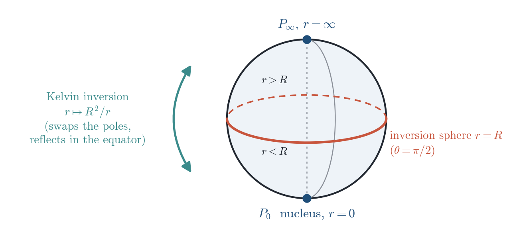

**Abstract.** The Madelung $n+l$ rule groups the one-electron levels of the periodic table by the sum $N=n+l$. Demkov and Ostrovsky (1971, 1972) modelled it by a zero-energy Schrödinger problem in the Tietz field, in which the levels with equal $N$ are degenerate; they state that the finite transformations of the symmetry group of their model are unknown. We show that this problem is, through the Kustaanheimo-Stiefel map and stereographic projection, the conformal Laplacian of the round 4-sphere restricted to functions invariant under the Kustaanheimo-Stiefel circle (Theorem A). This gives the spectrum, the group sizes $1,1,4,4,9,9,\dots$ and the Kelvin inversion as the swap of the two poles. The whole Demkov-Ostrovsky family is a family of spindles, smooth exactly for the Coulomb core (Theorem B). For $\mu\ne1$ and $Z\ne0$ the only point symmetries are rotations, reflections and the Kelvin inversion (Theorem C), so the hidden $\mathrm O(4)$, whose finite transformations we do not supply, is not realised by point maps. The zero-energy Green's function has a closed form (Theorem D). We assume the spin factor $2$ and the self-dual field, and we do not derive real atoms.

```{=latex}
\begingroup\small
This work is licensed under the Creative Commons Attribution 4.0 International License (CC BY 4.0), https://creativecommons.org/licenses/by/4.0/. The accompanying code is MIT-licensed.
\par\endgroup
```

# Introduction

**The Madelung rule.** In the order in which the subshells of neutral atoms are filled, the subshell with quantum numbers $(n,l)$ comes before $(n',l')$ when $n+l<n'+l'$, and when the sums are equal the one with the smaller $n$ comes first. This is the Madelung $n+l$ rule [27] (also called the Klechkowski rule [28]). It groups the levels into blocks $N=n+l$, $N=1,2,3,\dots$, each containing the pairs $(n,l)$ with $n\ge l+1$ and $n+l=N$ (Figure 1). With the spin factor $2$ the blocks hold $2,2,8,8,18,18,32,32,\dots$ electrons. These are the period lengths $2,8,8,18,18,32,32$ with one extra $2$ at the start; a block ends at an $s$ subshell and a period at a noble gas, so the blocks are not the periods, but the numbers are the same. Hydrogen has no such rule: its levels depend on $n$ alone, and its hidden symmetry is the rotation group $\mathrm{SO}(4)$, found by Fock [3] as the symmetry of free motion on the 3-sphere obtained by stereographic projection of momentum space. Fock's paper is the model for the kind of result proved here: a hidden degeneracy is explained by exhibiting the sphere on which the problem is a spectral problem of a standard operator.

{width=95%}

**The Demkov-Ostrovsky model.** Demkov and Ostrovsky [1] consider the zero-energy Schrödinger equation $\bigl[-\tfrac12\Delta+U_\mu(r)\bigr]\psi=0$ in $\mathbb R^3$ with the family of potentials $U_\mu(r)=-2v/\bigl(r^2R^2[(r/R)^\mu+(R/r)^\mu]^2\bigr)$, $\mu>0$, and regard $v$ as the eigenvalue (the coupling constant). For $\mu=1$ this is Maxwell's fish-eye, and the problem is the Laplace equation on a 3-sphere, in which the levels of each group $N$ form an $\mathrm{SO}(4)$ multiplet of dimension $N^2$ as in Fock's treatment of hydrogen. For general $\mu$ the levels are $v_N=R^2\mu^2\bigl(N+\tfrac1{2\mu}\bigr)\bigl(N+\tfrac1{2\mu}-1\bigr)$ with $N=n+(\mu^{-1}-1)l$ [1, Eq. (25)]. The member $\mu=\tfrac12$ gives $N=n+l$, the Madelung grouping, and it is the only member with a bare Coulomb core $U\sim-1/r$ at the nucleus [2, p. 67]; in physical terms it is the Tietz field $V_{\rm T}=-(Z/r)(1+r/R)^{-2}$. Demkov and Ostrovsky show that the problems for rational $\mu$ have $\mathrm{O}(4)$ symmetry, but they do not exhibit the transformations. On page 1086 of [1] they write: "the Sturm problems for all the Lenz potentials with rational $\mu$ have $\mathrm{O}(4)$ symmetry. The infinitesimal operators of the group can be constructed by analogy with the case of the anisotropic oscillator, but the finite transformations of the group are unknown." The case $\mu=\tfrac12$ is not put on a sphere in [1] or [2].

**What we prove.** Fix $R>0$. Throughout, $\pi:\mathbb R^4=\mathbb C^2\to\mathbb R^3$ is the Kustaanheimo-Stiefel (KS) map and $T$ the KS circle.

* **Theorem A** (the $S^4$ reading). The problem for $\mu=\tfrac12$ is unitarily equivalent to the conformal Laplacian of the round 4-sphere on $T$-invariant functions, with spectrum $Z_N=N(N+1)/(2R)$, groups of dimension $\lfloor (N+1)/2\rfloor^2=1,1,4,4,9,9,\dots$ with the labels $n+l=N$, and the Kelvin inversion as the pole swap, the scalar $(-1)^{N-1}$ on group $N$.
* **Theorem B** (spindle). For every $\mu$ the lift is a 4-dimensional spindle with cone parameter $2\mu$ at both poles, smooth if and only if $\mu=\tfrac12$; the Sturm operator on $C_c^\infty(\mathbb R^3\setminus\{0\})$ is essentially self-adjoint if and only if $\mu\le\tfrac12$.
* **Theorem C** (no point realisations). For every $\mu\ne1$ and $Z\ne0$ the group of point symmetries is $\mathrm{O}(3)\times\mathbb Z_2$.
* **Theorem D** (Green's function). The zero-energy Green's function is, in closed form, a weighted average over the KS fibre of the resolvent kernel of the 4-sphere, with an addition formula for the group projectors.

A short Proposition $\Gamma_N$ identifies each group, as a representation of the rotation group, with a hydrogen shell taken twice, which explains the doubling $1,1,4,4,9,9$.

**What we do not claim.** We do not derive real atoms. The paper explains a model, not the periodic table. Two inputs are put in by hand: the spin factor $2$ (Hypothesis S: it is an assumption, not a lemma) and the self-dual field, that is, the Tietz form invariant under the Kelvin inversion. Ordering the levels by zero-energy coupling is Demkov and Ostrovsky's assumption, not derived here. The Madelung rule is known to fail for large $Z$ [14]. We do not supply the finite transformations of the $\mathrm{O}(4)$ of Demkov and Ostrovsky: Theorem C rules out point realisations for $\mu\ne1$, but it does not exclude realisations of Fock type (point maps of another space reached by an integral transform), so it does not show that the finite transformations cannot exist. All novelty statements read "to our knowledge, in the sources we could consult".

**Related work.** The step from $\mathbb R^4$ to $S^4$ is the linearisation of the bubble problem of Rey [5] and Bianchi and Egnell [4]; the KS map is due to Kustaanheimo and Stiefel [11] and is used for the Coulomb problem by Kibler and Negadi [12]. The planar shadow of the spindle, a branched cover $z\mapsto z^\mu$, is known in optics: Sarbort and Tyc [6, Eq. (22) and Table 1] and Xu, Wang, Tyc and others [7, Table 1] describe the "generalized Maxwell fish-eye" as a geodesic lens on a spindle with cone angle $2\pi\mu$, smooth only for $\mu=1$; they do not lift by the KS map and do not state the smoothness condition we prove for the lifted spindle. Kholodenko and Kauffman [8] and Kholodenko [9] treat the Tietz field through the conformal Laplacian of the 3-sphere and the Hopf map; we compare their statement in Section 3.3. Hostler [10] gave Green's functions of the Coulomb problem in closed form, and Theorem D has that form. Kitagawara and Barut [15, 16] studied the dynamical symmetry of the Demkov-Ostrovsky model with Lie-algebraic methods, and Ostrovsky [17] its group theory; we cite them from their abstracts and from papers that cite them (full text not consulted), and this is the main risk to our priority claims. Belokolos [13] and Rosu and others [18] also use the Tietz field and the Demkov-Ostrovsky weight without a 4-sphere or the KS map.

# Setup

**The problem.** The Tietz weight is
$$
w(x)=\frac{2}{|x|\,(1+|x|/R)^2},\qquad x\in\mathbb R^3 .
$$
The equation $-\tfrac12\Delta\psi+V_{\rm T}\psi=0$ with $V_{\rm T}=-(Z/r)(1+r/R)^{-2}$ is the *zero-energy coupling problem*
$$
-\Delta\psi=Z\,w\,\psi\quad\text{in }\mathbb R^3 ,\tag{2.1}
$$
with $Z$ the eigenvalue. (For general $\mu$, $w_\mu$ is the weight of the Demkov-Ostrovsky family, with $U_\mu$ as in Section 1; at $\mu=\tfrac12$ it is $w$ above, and $U_{1/2}=-(2v/R^3)/\bigl(r(1+r/R)^2\bigr)$ gives $Z=2v/R^3$. The exact normalisation is (4.1).)

**The space.** Equation (2.1) is posed in the Hilbert space $L^2(\mathbb R^3,w\,dx)$ with the energy form $q(\psi)=\int|\nabla\psi|^2dx$ on the homogeneous Sobolev space $D^{1,2}(\mathbb R^3)$, the completion of $C_c^\infty(\mathbb R^3)$ in the norm $\|\nabla f\|_2$ (by the Sobolev inequality a space of functions in $L^6$). Eigenfunctions are not required to lie in $L^2(\mathbb R^3,dx)$, and this is forced: the states with $l=0$ decay like $1/r$, so they are not square integrable, and they are zero-energy resonances rather than bound states. Every group $n+l=N$ contains the state $(n,l)=(N,0)$. If the problem were posed in $L^2(\mathbb R^3,dx)$, every group would lose one state and the sizes would be $0,0,3,3,8,8,\dots$. The space $D^{1,2}$ is also the one that selects, with no condition imposed by hand, the regular solutions that decrease at infinity.

**The KS map.** Write $u=(z_1,z_2)\in\mathbb C^2=\mathbb R^4$. The KS map, in its Hopf form, is
$$
\pi(u)=x,\qquad x_1+ix_2=2z_1\bar z_2,\quad x_3=|z_1|^2-|z_2|^2,\qquad |x|=|u|^2 .
$$
(The original KS convention differs by an orthogonal change of coordinates in $\mathbb R^4$ and $\mathbb R^3$; every statement below is invariant under it.) The KS circle $T$ acts by $(z_1,z_2)\mapsto e^{i\zeta}(z_1,z_2)$. It preserves $\pi$, acts freely on $\mathbb R^4\setminus\{0\}$, and its orbits are the fibres $\pi^{-1}(x)$, $x\ne0$. A function is *phase-free* if it is $T$-invariant.

**The sphere.** Let $a=\sqrt R$ and let $S^4_a\subset\mathbb R^5=\mathbb R^4\times\mathbb R$ be the round sphere of radius $a$, with coordinates $(y,t)$. Stereographic projection from the pole $P_\infty=(0,a)$ onto $t=0$ gives coordinates $u\in\mathbb R^4$,
$$
\xi(u)=\Bigl(\frac{2Ru}{R+|u|^2},\ \frac{a(|u|^2-R)}{R+|u|^2}\Bigr),\qquad \xi^*g_{\rm round}=\Omega^2\delta,\qquad \Omega(u)=\frac{2}{1+|u|^2/R}.
$$
The point $u=0$ is the pole $P_0$ (the nucleus, $r=0$), and $u\to\infty$ is $P_\infty$ ($r\to\infty$); Figure 2 shows the picture. The circle $T$ extends to $S^4_a$ as the rotations $(y,t)\mapsto(e^{i\zeta}y,t)$, with fixed set $\{P_0,P_\infty\}$. In dimension $4$ the conformal Laplacian is $L_g=-\Delta_g+\mathrm{Scal}_g/6$; on $S^4_a$, $\mathrm{Scal}=12/a^2$, so $L=-\Delta_g+2/a^2$.

{width=100%}

# Theorem A: the $S^4$ reading

## Statement

**Theorem A.** *Let $V\psi=\sqrt{2/\pi}\;\Omega^{-1}(\psi\circ\pi)$, read as a function on $S^4_a$ through $\xi$.*

1. *(Lift.) $V$ is a unitary map from $L^2(\mathbb R^3,w\,dx)$ onto the space $L^2_T(S^4_a)$ of $T$-invariant functions, it maps $D^{1,2}(\mathbb R^3)$ onto $H^1_T(S^4_a)$, and it carries the problem (2.1) to $L\Phi=\lambda\Phi$ on $T$-invariant functions, with $\lambda=2Z$. Both quadratic forms are preserved up to a fixed constant.*
2. *(Spectrum.) The eigenvalues of (2.1) are exactly $Z_N=N(N+1)/(2R)$, $N=1,2,3,\dots$, and there is no other spectrum.*
3. *(Groups.) The eigenspace $E_N$ is spanned by the states with labels $(n,l,m)$, $n+l=N$, $n\ge l+1$, $|m|\le l$. Its dimension is $\lfloor (N+1)/2\rfloor^2=1,1,4,4,9,9,\dots$ (Madelung's $n+l$ rule). A degree-$k$ harmonic of $S^4$ has $\mathrm{SO}(4)$ types $j=0,\dots,k$; $T$-invariants exist only for $j=2l$, and $k+1=n+l$.*
4. *(Inversion.) The Kelvin transform $\psi\mapsto(R/r)\,\psi(R^2x/r^2)$, Demkov and Ostrovsky's inversion symmetry, is the reflection of $S^4_a$ that swaps its two poles (nucleus and infinity). It acts on group $N$ by the scalar $(-1)^{N-1}$.*

The Kelvin inversion is the reflection in the equator of Figure 2. The basis functions are explicit. With $n_r=n-l-1$ the number of radial nodes,
$$
\psi_{nlm}(x)=\mathrm{const}\cdot\Bigl(\frac rR\Bigr)^{l}\Bigl(1+\frac rR\Bigr)^{-(2l+1)}\,C^{(2l+3/2)}_{n_r}\!\Bigl(\frac{R-r}{R+r}\Bigr)\,Y_{lm}(x/r),
$$
which is Demkov and Ostrovsky's Eq. (26) of [1] at $\mu=\tfrac12$. Each $\psi_{nlm}$ is continuous at $0$ with $\psi\sim c_0r^l$, and $\psi\sim c_1r^{-l-1}$ as $r\to\infty$, with $c_0,c_1\ne0$.

The pieces are not all new. Items 2 and 3, as grouped, are in [1] and [2]; the step from $\mathbb R^4$ to $S^4$ is the bubble linearisation of [4] and [5]; the step from $\mathbb R^3$ to $\mathbb R^4$ is the KS map [11, 12]. What is new, to our knowledge in the sources we could consult, is the composition, the count of circle-invariant harmonics, and the reading of Kelvin as the pole swap.

## Proof

The proof has six steps. Independent checks of the formulas used in Steps 3, 5 and 6 are described at the end of this section and in Appendix A.7.

**Step 1 (the KS lift).** *For $C^2$ functions $f$ on an open set of $\mathbb R^3$,*
$$
\Delta_4(f\circ\pi)(u)=4|u|^2(\Delta_3f)(\pi(u)),\qquad |\nabla_4(f\circ\pi)|^2=4|u|^2|\nabla_3f|^2(\pi(u)),
$$
*and for measurable $g\ge0$,* $\int_{\mathbb R^4}g(\pi(u))\,du=\frac\pi4\int_{\mathbb R^3}g(x)\,|x|^{-1}dx$.

Each coordinate $x_i$ of $\pi$ is a quadratic form in $u$ with $\Delta_4x_i=0$ (for example $x_3=u_1^2+u_2^2-u_3^2-u_4^2$ has Laplacian $2+2-2-2=0$), and $\nabla x_i\cdot\nabla x_j=4|u|^2\delta_{ij}$. The chain rule gives the first two identities. The Jacobian $D\pi$ satisfies $D\pi\,D\pi^{T}=4|u|^2I_3$, so its normal Jacobian is $8|u|^3$; each fibre is a circle of length $2\pi|u|$, and the coarea formula gives $\int g(\pi(u))\,du=\int g(x)\,\frac{2\pi|u|}{8|u|^3}\,dx=\frac\pi4\int g(x)|x|^{-1}dx$. Put $W(u)=4|u|^2\,w(|u|^2)=8/(1+|u|^2/R)^2$. Applying the integral identity to $4|x||\nabla\psi|^2$ and $4|x|w\psi^2$, for $\psi\in C_c^\infty(\mathbb R^3)$ and $F=\psi\circ\pi$,
$$
\int_{\mathbb R^4}|\nabla F|^2du=\pi\int_{\mathbb R^3}|\nabla\psi|^2dx,\qquad \int_{\mathbb R^4}WF^2du=\pi\int_{\mathbb R^3}w\psi^2dx,
$$
and (2.1) becomes $-\Delta_4F=Z\,W\,F$. The operator identity behind the first identity, $\Delta_x=\frac1{4r}\bigl[\Delta_u-\frac1rX^2\bigr]$ with $X$ the generator of $T$, is Eq. (20) of Kibler and Negadi [12].

**Step 2 (conformal covariance).** *With $W=2\Omega^2$ and $F=\Omega\Phi$,*
$$
-\Delta_4(\Omega\Phi)=\Omega^3\bigl(-\Delta_g\Phi+(2/R)\Phi\bigr)=\Omega^3L\Phi .
$$
Indeed $W=2\Omega^2$ is immediate. For $g=\Omega^2\delta$ in dimension $4$, $\Delta_g\Phi=\Omega^{-2}(\Delta\Phi+2\Omega^{-1}\nabla\Omega\cdot\nabla\Phi)$, and expanding, $-\Delta(\Omega\Phi)=-\Omega^3\Delta_g\Phi-\Phi\,\Delta\Omega$. So the claim is equivalent to $-\Delta_4\Omega=(2/R)\Omega^3$, a direct computation: with $s=|u|^2$ one has $\Delta_4=4s\partial_s^2+8\partial_s$ on radial functions, and $-\Delta_4\Omega=16/(R(1+s/R)^3)=(2/R)\Omega^3$. The same identity gives $\mathrm{Scal}_g=-6\Omega^{-3}\Delta_4\Omega=12/R$. (This is the transformation law of the conformal Laplacian, Eq. (2.7) of Lee and Parker [19].) Hence $-\Delta_4F=ZWF$ is equivalent to $L\Phi=2Z\Phi$ on $S^4_a$ minus $P_\infty$, which is the equation of item 1 with $\lambda=2Z$. For $F\in C_c^\infty(\mathbb R^4)$ and $\Phi=F/\Omega$, integration by parts and $dv_g=\Omega^4du$ give
$$
\int|\nabla F|^2du=E(\Phi):=\int_{S^4_a}\bigl(|\nabla_g\Phi|^2+\tfrac2R\Phi^2\bigr)dv_g,\qquad \int WF^2du=2\int_{S^4_a}\Phi^2dv_g .
$$
On the unit $S^4$, $-\Delta$ has eigenvalues $k(k+3)$ on the space $\mathcal H_k$ of degree-$k$ spherical harmonics, and $L^2(S^4)=\bigoplus_k\mathcal H_k$. On $S^4_a$ divide by $a^2=R$, so $L$ has eigenvalues $(k+1)(k+2)/R$ on $\mathcal H_k$.

**Step 3 (spectral equivalence, both poles).** The operator $A$ of problem (2.1) is the self-adjoint operator in $L^2(\mathbb R^3,w\,dx)$ of the closed form $q$ on $D^{1,2}(\mathbb R^3)$. The full argument is in Appendix A.5; its steps are as follows.

(a) *The form is closed.* Hardy's inequality and $r^2w\le R/2$ give $\int w\psi^2\,dx\le 2R\int|\nabla\psi|^2dx$ (3.1), so $D^{1,2}(\mathbb R^3)$ embeds in $L^2(w\,dx)$, $q$ is closed, and it is densely defined; Kato's theorem defines $A$.

(b) *The pole $r=0$.* The map $J\psi=\psi\circ\pi$ extends to an isometry (up to $\sqrt\pi$) from $D^{1,2}(\mathbb R^3)$ onto $D^{1,2}_T(\mathbb R^4)$: onto because averaging over $T$ preserves $C_c^\infty$, and a $T$-invariant smooth $F$ has $\nabla F(0)=0$, so $F=\psi\circ\pi$ with $\psi$ Lipschitz. No condition at $r=0$ is imposed by hand.

(c) *The pole $r=\infty$.* $CF=F/\Omega$ is an isometry of $D^{1,2}_T(\mathbb R^4)$ onto $H^1_T(S^4_a)$ for the form $E$ of Step 2, because a point has zero capacity in dimension $4$. No decay condition is imposed by hand.

(d) *Unitary equivalence.* $V=\sqrt{2/\pi}\,CJ$ is isometric on $L^2(w\,dx)$, onto $L^2_T(S^4_a)$ (average over $T$, so $F=\Omega\Phi$ is constant on the fibres of $\pi$), and $\tfrac12E(V\psi)=q(\psi)$ with form domains matched. Two closed forms intertwined by a unitary give unitarily equivalent operators, so $VAV^{-1}=\tfrac12L|_{L^2_T}$. This proves item 1.

**Step 4 (the spectrum, item 2).** The operator $\tfrac12L$ on $L^2_T$ has compact resolvent, eigenvalues $(k+1)(k+2)/(2R)$ on $\mathcal H_k^T$, and nothing else. By unitary equivalence $A$ has purely discrete spectrum with the same eigenvalues and multiplicities, and the eigenfunctions are $\psi=\sqrt{\pi/2}\,\Omega\,Y\circ\xi$ with $Y\in\mathcal H_k^T$. Step 5 shows that $\mathcal H_k^T$ is never zero (it contains the zonal harmonic, $l=0$), so every $k\ge0$ occurs, and with $N=k+1$ we get $Z_N=N(N+1)/(2R)$, $N=1,2,3,\dots$. Eigenfunctions are real analytic on $\mathbb R^3\setminus\{0\}$, since $Y$ is a polynomial restricted to the sphere. The other radial solutions of (2.1) behave like $r^{-l-1}$ at $0$ or like $r^l$ at infinity; they are not in $D^{1,2}(\mathbb R^3)$ (at $0$, $|\nabla\psi|^2\sim r^{-2l-4}$ is not integrable against $r^2dr$; at infinity $r^l\notin L^6$). So $D^{1,2}$ selects exactly Demkov and Ostrovsky's "regular solutions which decrease at infinity".

For $l=0$, $\psi\sim c_1/r$ at infinity with $c_1\ne0$, so $\psi\notin L^2(\mathbb R^3,dx)$: the $l=0$ states are zero-energy resonances, as said in Section 2. For $l\ge1$ the decay $r^{-l-1}$ is square integrable.

**Step 5 (the count, item 3).** *$\mathcal H_k^T$ is the orthogonal sum over $l=0,\dots,\lfloor k/2\rfloor$ of spaces of dimension $2l+1$, the $l$-th consisting of*
$$
Y(\theta,\omega)=\sin^{2l}\theta\;C^{(2l+3/2)}_{k-2l}(\cos\theta)\,h(\omega),\qquad h\in\mathcal H_{l,l},
$$
*where $\theta$ is the polar angle from $P_0$ (so $\cos\theta=(R-r)/(R+r)$), $\omega\in S^3$, and $\mathcal H_{l,l}$ is the space of harmonic polynomials on $\mathbb C^2$ of bidegree $(l,l)$ in $(z,\bar z)$.*

(i) *Branching $\mathrm{SO}(5)\to\mathrm{SO}(4)$.* Write the unit $S^4$ as $\theta\in[0,\pi]$, $\omega\in S^3$. For $h$ a degree-$j$ harmonic on $\mathbb R^4$ (so $-\Delta_{S^3}h=j(j+2)h$) and $Y=\sin^j\theta\,G(\cos\theta)\,h$, the equation $-\Delta_{S^4}Y=k(k+3)Y$ reduces to the Gegenbauer equation with parameter $j+\tfrac32$ and degree $k-j$, solved by $G=C^{(j+3/2)}_{k-j}$. Different $(j,h)$ give orthogonal functions, and $\sum_{j=0}^k(j+1)^2=(k+1)(k+2)(2k+3)/6=\dim\mathcal H_k(\mathbb R^5)$, so $\mathcal H_k(\mathbb R^5)$ is the direct sum over $j=0,\dots,k$ of these blocks.

(ii) *Circle-invariants.* $T$ acts only on $\omega$, so $\mathcal H_k^T$ is the same sum with $h$ in $\mathcal H_j(\mathbb R^4)^T$. A polynomial on $\mathbb C^2$ is a sum of bihomogeneous parts of bidegree $(p,q)$, $p+q=j$, and $\Delta_4=4\sum\partial_{z_i}\partial_{\bar z_i}$ preserves bidegree, so $\mathcal H_j=\bigoplus\mathcal H_{p,q}$. The element $e^{i\zeta}$ of $T$ multiplies $\mathcal H_{p,q}$ by $e^{i(p-q)\zeta}$, so $\mathcal H_j^T=\mathcal H_{l,l}$ if $j=2l$ and $0$ if $j$ is odd. Moreover $\dim\mathcal H_{p,q}=p+q+1$: bihomogeneous polynomials of bidegree $(p,q)$ have dimension $(p+1)(q+1)$ and the Laplacian maps them onto bidegree $(p-1,q-1)$ (it is the adjoint of multiplication by $|z|^2$ in the Fischer inner product, which is injective), so the kernel has dimension $(p+1)(q+1)-pq=p+q+1$. Hence $\dim\mathcal H_{l,l}=2l+1$.

(iii) *The labels $(l,m)$.* For a solid harmonic $P$ of degree $l$ on $\mathbb R^3$, $P\circ\pi$ is a harmonic polynomial on $\mathbb R^4$ (Step 1), homogeneous of degree $2l$ and $T$-invariant, so it lies in $\mathcal H_{l,l}$. The map $P\mapsto P\circ\pi$ is injective ($\pi$ is onto) between spaces of the same dimension $2l+1$, hence onto. So the $\omega$-factor of a $T$-invariant harmonic in the block $j=2l$ is exactly $Y_{lm}(x/r)$, $|m|\le l$, read through $\pi$, and the 3D eigenfunction has angular momentum $l$.

(iv) *Nodes.* The variable $\cos\theta=(R-r)/(R+r)$ is strictly monotone in $r$ and $\Omega>0$, so the radial nodes of $\psi$ are the zeros of $C^{(2l+3/2)}_{k-2l}$ in $(-1,1)$; there are $k-2l$ of them, all simple. Thus $n_r=k-2l$, and with $n=n_r+l+1$ we get $n+l=k+1=N$ and $n\ge l+1$. Summing,
$$
\dim\mathcal H_k^T=\sum_{l=0}^{\lfloor k/2\rfloor}(2l+1)=\Bigl(\lfloor k/2\rfloor+1\Bigr)^2=\Bigl\lfloor\frac{N+1}{2}\Bigr\rfloor^2=1,1,4,4,9,9,\dots
$$
This proves item 3. The explicit form of $\psi_{nlm}$ stated after Theorem A follows from $\sin\theta=2\sqrt{rR}/(R+r)$ and the lift $\psi=\sqrt{\pi/2}\,\Omega\,Y$; it agrees with [1, Eq. (26)] at $\mu=\tfrac12$.

**Step 6 (Kelvin is the pole swap, item 4).** Let $K_3\psi(x)=(R/r)\psi(R^2x/r^2)$, and let $\iota(u)=Ru/|u|^2$ be the inversion of $\mathbb R^4$ in the sphere $|u|=a$, the equator of $S^4_a$ in stereographic coordinates. (a) $\pi$ is homogeneous of degree $2$, so $\pi(\iota u)=R^2\pi(u)/|\pi(u)|^2$. (b) Hence $(K_3\psi)\circ\pi=K_4(\psi\circ\pi)$ with $K_4F(u)=(a/|u|)^2F(\iota u)$ and constant exactly $1$ (since $a^2=R$). (c) The point $\xi(\iota u)$ has the same first four coordinates as $\xi(u)$ and the opposite last coordinate, and $\Omega(\iota u)=(|u|^2/R)\,\Omega(u)$, so $\iota$ is the reflection $\sigma:(y,t)\mapsto(y,-t)$ of $S^4_a$, which swaps $P_0$ (nucleus) and $P_\infty$ (infinity), and $\Omega^{-1}K_4F=(\Omega^{-1}F)\circ\sigma$. (d) The weight is Kelvin invariant: $(R/r)^4w(R^2/r)=w(r)$, so $K_3$ maps eigenfunctions of $Z_N$ to eigenfunctions of $Z_N$. The reflection $\sigma$ is an isometry commuting with $T$ and $L$, so it permutes the eigenspaces $\mathcal H_k^T$; on the block $l$ of Step 5 it acts by the parity of $C_{k-2l}$ under $\cos\theta\mapsto-\cos\theta$, that is by $(-1)^{k-2l}=(-1)^k$, which does not depend on $l$. So $K_3$ acts on the whole group $N$ as the scalar $(-1)^k=(-1)^{N-1}$. Since $K_3$ corresponds to $\sigma$, which preserves $H^1_T(S^4_a)$, it preserves $D^{1,2}(\mathbb R^3)$. The inversion is stated in [1] as Eq. (8) and footnote 4. This proves item 4 and Theorem A. $\qquad\blacksquare$

**Checks.** Steps 4, 5 and 6 are tested by independent scripts (Section 9; details in Appendix A.7); all held. They cover the algebra, not the functional analysis of Step 3.

## Relation to Kholodenko's S$^3$ relabelling

Kholodenko [9, Eq. (14b); derivation in [8, Sec. 4.6]] derives the Madelung rule from the conformal Laplacian of the round 3-sphere. His argument uses the conformal invariance of that operator, the Hopf map to pass between $S^3$ and the angular variables of the central problem, and a family of conformal transformations indexed by a parameter $\gamma$. He writes that these transformations "only cause relabeling of the indices" of the hydrogen harmonics, that the choice $\gamma=1$ gives the hydrogen atom, and that the choice $\gamma=1/2$ leads to $L^2Y_{n+l,lm}=I_{n+l,l}Y_{n+l,lm}$ (his Eq. (14b)), "implying the canonical Madelung rule". In effect the state with labels $(n,l,m)$ is placed at the spherical harmonic $Y_{n+l,l,m}$ on the round 3-sphere. Two things in this are right: the counts come out right, and the Hopf map is the correct angular ingredient, as (b) below itself shows. We show that this is a relabelling, that it is not a restriction or reduction of Theorem A, and what $S^3$ statement Theorem A does imply.

*Notation.* Let $\mathbb H_K$ be the space of harmonics of degree $K-1$ on the round $S^3$ ($K=1,2,\dots$). It has dimension $K^2$, is irreducible of type $\tfrac{K-1}2\times\tfrac{K-1}2$ under $\mathrm{SO}(4)$, and contains each spin $l=0,\dots,K-1$ exactly once under the diagonal $\mathrm{SO}(3)$. Hydrogen shell $n$ is $\mathbb H_n$.

**(a) It is a relabelling, not an equivalence.** The map $\rho(n,l,m)=(n+l,l,m)$ sends group $N$ ($n+l=N$, $n\ge l+1$) into $\mathbb H_N$, with image $\mathbb H_N^{\le p}$ equal to the spin $l\le p$ part of $\mathbb H_N$, where $p=\lfloor(N-1)/2\rfloor$, of dimension $(p+1)^2$. The eigenvalue equation on $S^3$ holds on $\mathbb H_N^{\le p}$ only because it holds on all of $\mathbb H_N$. The space $\mathbb H_N^{\le p}$ is $\mathrm{SO}(3)$-invariant but not $\mathrm{SO}(4)$-invariant for $N\ge2$. Every $\mathrm{SO}(4)$-invariant operator on $L^2(S^3)$ is a scalar on each $\mathbb H_K$ (Schur: the $\mathbb H_K$ are irreducible and pairwise inequivalent), so no $\mathrm{SO}(4)$-invariant operator on $S^3$ has the $\mathbb H_N^{\le p}$ as eigenspaces. The restriction $l\le p$ is the hydrogen condition $n\ge l+1$ written in the new labels, and it is put in by hand. The same construction with $(n,l,m)\mapsto(n+cl,l,m)$ gives an "$n+cl$ rule" for every integer $c\ge0$: Eq. (14b) holds for any $\mathrm{SO}(3)$-equivariant labelling and carries no information about the Lenz operator at $\mu=\tfrac12$.

Analytically, the $\mu=\tfrac12$ equation is the eigenequation of the 3D conformal Laplacian of $g_{1/2}$, the case $\mu=\tfrac12$ of the metric $g_\mu=w_\mu|dx|^2$ of Section 5.1. Conformal covariance of the conformal Laplacian does not make its spectrum conformally invariant, because the term $Zf$ depends on the metric and not only on its conformal class. For $\mu=1$, $g_1$ is the round $S^3$ (multiplicities $N^2$). For $\mu=\tfrac12$, $g_{1/2}$ is a spindle over $S^2$ with cone parameter $\tfrac12$ at both poles, with nonconstant scalar curvature (5.1) and multiplicities $(p+1)^2$. These are different metrics with different spectra, so the identification with the round $S^3$ is a relabelling of states, not an equivalence of operators.

**(b) Theorem A restricted to $S^3$ slices is not Kholodenko's statement.** Write $S^4_a\subset\mathbb R^5=\mathbb R^4\times\mathbb R$ with coordinates $(u,t)$, poles $P_0$ (the nucleus) and $P_\infty$ (infinity), and polar angle $\theta$ with $\cos\theta=(R-r)/(R+r)$. The level sets of $\theta$ are the 3-spheres $|u|^2=r$, which are the KS circle bundles over the spheres $|x|=r$. Under the pole isotropy $\mathrm{SO}(4)$, a degree-$k$ harmonic of $S^4$ of $\mathrm{SO}(4)$ type $j$ is $\sin^j\theta\,C^{(j+3/2)}_{k-j}(\cos\theta)\,h(\omega)$, with $h$ a degree-$j$ harmonic of $S^3$ (Step 5). Invariance under $T$ forces $j=2l$ and $h=Y_{lm}\circ\mathrm{Hopf}$. So $\psi_{Nlm}$ lifts to
$$
\sin^{2l}\theta\;C^{(2l+3/2)}_{N-1-2l}(\cos\theta)\;(Y_{lm}\circ\mathrm{Hopf})(\omega),
$$
with $n-l-1=N-1-2l$ polar nodes. The $S^3$ factor has degree $2l$, not $N-1$: the label $n+l$ is the degree on $S^4$ and is invisible on any $S^3$ slice. A slice sees only the Hopf correspondence $\mathbb H_{2l+1}(S^3)^T=$ degree-$l$ harmonics of $S^2$, the angular part of every central problem. Kholodenko's $S^3$ is the hydrogen sphere (Fock's, the fish-eye case $\mu=1$), not a slice of $S^4_a$. So his statement is neither a restriction nor a reduction of Theorem A.

**(c) The $S^3$ statement that Theorem A does imply.** Through the map $\Gamma_N$ of Proposition $\Gamma_N$ (Section 7), $E_N$ is $\mathrm{SO}(3)$-equivariantly the hydrogen shell $\mathbb H_{p+1}$, so
$$
\bigoplus_NE_N\;\cong\;\Bigl(\bigoplus_n\mathbb H_n\Bigr)\otimes\mathbb C^2 ,
$$
with group $N=2n-1$ (Kelvin even) and group $N=2n$ (Kelvin odd) both being shell $n$. The true $S^3$ shadow is "each hydrogen shell twice", not "shell $N$ cut to $l\le p$". It explains the doubling $1,1,4,4,9,9$ and is still a relabelling at the level of $\mathrm{O}(4)$ (Section 7); its geometric content is that the data live on the equatorial 3-sphere of $S^4_a$, the KS preimage of the Kelvin sphere $r=R$.

**(d) What only $S^4$ carries.**

* *The Kelvin pole swap.* On $S^4$ the reflection $t\mapsto-t$ acts on type $j$ by $(-1)^{k-j}$ (Gegenbauer parity); with $j=2l$ this is the scalar $(-1)^{N-1}$ on group $N$ (Step 6). The pole swap of the hydrogen $S^3$ acts on $Y_{N,l,m}$ by $(-1)^{N-1-l}$, which is not constant on a group: in the relabelled picture Kelvin is not geometric.
* *Spindle and smoothness.* In 3D the metric $g_{1/2}$ has cone parameter $\tfrac12$ at both poles and is singular; after the KS lift the parameter doubles to $2\mu=1$ and the sphere is smooth (Theorem B). The planar route ($z\mapsto z^\mu$ on a branched cover) has no 3D analogue (Theorem C).
* *The Green's function and self-adjointness.* A relabelling is not an operator identity and gives no kernel: $G_Z$ of Theorem D comes from the unitary equivalence of Theorem A, item 1, and a kernel from the $S^3$ Laplacian has multiplicities $N^2$. The limit point and limit circle analysis of Theorem B concerns the Lenz operator and has no counterpart for a relabelling.

# Theorem B: the spindle, smooth iff $\mu=\tfrac12$

## Statement

For $\mu>0$ let $U_\mu$ be the potential of Section 1 and put $\chi=\ln(r/R)$. The weight of the family is
$$
w_\mu(x)=\frac{R}{2\,r^2\cosh^2(\mu\chi)} ,\tag{4.1}
$$
which equals $w$ of Section 2 at $\mu=\tfrac12$ (since $r^2w=2r/(1+r/R)^2=R/(2\cosh^2(\chi/2))$). Because $(r/R)^\mu+(R/r)^\mu=2\cosh(\mu\chi)$, the equation $\bigl[-\tfrac12\Delta+U_\mu\bigr]\psi=0$ is
$$
-\Delta\psi=Z\,w_\mu\,\psi,\qquad Z=\frac{2v}{R^3},\tag{4.2}
$$
for every $\mu$. The Sturm operator is $A_\mu=-w_\mu^{-1}\Delta$ in $L^2(\mathbb R^3,w_\mu\,dx)$. As in Section 3, the form $q$ on $D^{1,2}(\mathbb R^3)$ defines a self-adjoint realisation of it, the Friedrichs (form) realisation. Put $|u|^2=r$ and
$$
\Omega_\mu^2=\frac{4\mu^2R\,\operatorname{sech}^2(\mu\chi)}{|u|^2},\qquad g_\mu^{(4)}=\Omega_\mu^2\,\delta\ \text{ on }\mathbb R^4\setminus\{0\}.
$$

**Theorem B.** *(1) (Lift.) The Kustaanheimo-Stiefel lift of (4.2) is $-\Delta_4F=\lambda\,\Omega_\mu^2F$ with $\lambda=Z/(2\mu^2)$, that is $L_{g^{(4)}_\mu}\Phi=\lambda\Phi$ with $\Phi=F/\Omega_\mu$, where $L_g$ is the conformal Laplacian of $g$.*

*(2) (Spindle.) With $\cos\theta=-\tanh(\mu\chi)$, $\theta\in(0,\pi)$ (at $\mu=\tfrac12$ this is $\cos\theta=(R-r)/(R+r)$, the angle from the nucleus of Section 2),*
$$
g^{(4)}_\mu=R\bigl(d\theta^2+(2\mu)^2\sin^2\theta\;g_{S^3}\bigr).
$$
*Near each pole this is the metric cone over a round 3-sphere of radius $2\mu$. The metric extends smoothly across both poles if and only if $\mu=\tfrac12$, where it is the round $S^4_a$. In three dimensions the same weight gives the cone over $S^2$ of radius $\mu$, smooth only for $\mu=1$. At the nucleus, $U_\mu\sim-2vR^{-2-2\mu}r^{2\mu-2}$ is a bare Coulomb core exactly when $\mu=\tfrac12$.*

*(3) (Spectrum.) The spectrum of the Friedrichs realisation is $Z_N=\dfrac{2}{R}\,\mu^2\bigl(N+\tfrac1{2\mu}\bigr)\bigl(N+\tfrac1{2\mu}-1\bigr)$ with $N=n+(\mu^{-1}-1)l$, $n=n_r+l+1$; equivalently $v_N=R^2\mu^2\bigl(N+\tfrac1{2\mu}\bigr)\bigl(N+\tfrac1{2\mu}-1\bigr)$, which is Eq. (25) of [1]. There is no other spectrum.*

*(4) (Self-adjointness.) In the sector of angular momentum $l$ the radial index is $\kappa_l=(2l+1)/(2\mu)$. Both ends of the radial problem are limit point if $\kappa_l\ge1$ and limit circle if $\kappa_l<1$. Hence the minimal operator $A_\mu$ on $C_c^\infty(\mathbb R^3\setminus\{0\})$ has a unique self-adjoint realisation if and only if $\mu\le\tfrac12$. For $\mu>\tfrac12$ the Friedrichs realisation is one valid choice among several.*

Figure 3 shows the three cases $\mu<\tfrac12$, $\mu=\tfrac12$, $\mu>\tfrac12$. At $\mu=\tfrac12$ one has $\kappa_l=2l+1\ge1$ in every sector, so the unique realisation is the one of Theorem A and no condition at the nucleus or at infinity is a choice. Thus $\mu=\tfrac12$ is the largest $\mu$ with a unique dynamics, and the only $\mu$ for which the lifted space is a smooth manifold; these two readings agree.

{width=85%}

**What is known and what is new.** The planar shadow of the spindle is the optics spindle of Section 1 [6, 7], that is the branched cover $z\mapsto z^\mu$ that Demkov and Ostrovsky mention on page 1086 of [1]. The separation of variables and the Pöschl-Teller reduction in (3) are those of [1] and are reproduced here as a check. To our knowledge, in the sources we could consult, the new part is the doubling of the cone parameter to $2\mu$ by the Kustaanheimo-Stiefel map, the statement "smooth if and only if $\mu=\tfrac12$" for the lifted spindle, and the sector-by-sector classification of the self-adjoint realisations in (4).

## Proof

**(1) The lift.** By Step 1 of Section 3.2, $-\Delta\psi=Zw_\mu\psi$ becomes $-\Delta_4F=Z\,W_\mu F$ with $W_\mu=4|u|^2w_\mu(|u|^2)=2R/\bigl(|u|^2\cosh^2(\mu\chi)\bigr)$, and $W_\mu=\Omega_\mu^2/(2\mu^2)$. The covariance law $-\Delta_4(\Omega\Phi)=\Omega^3L_{\Omega^2\delta}\Phi$ holds for every positive conformal factor $\Omega$ in dimension $4$ (Lee and Parker [19, Eq. (2.7)]), which gives the second form.

**(2) The spindle.** Since $\delta=|u|^2(d\tau^2+g_{S^3})$ with $\tau=\ln|u|$, we get $g_\mu^{(4)}=4\mu^2R\,\operatorname{sech}^2(\mu\chi)(d\tau^2+g_{S^3})$ with $\chi=2\tau-\ln R$. For $\cos\theta=-\tanh(\mu\chi)$ one has $\sin\theta=\operatorname{sech}(\mu\chi)$ and $d\theta=2\mu\operatorname{sech}(\mu\chi)\,d\tau$, so the formula for $g_\mu^{(4)}$ follows. As $\theta\to0$ (the pole $P_0$, the nucleus) it is $R(d\theta^2+\theta^2(2\mu)^2g_{S^3})$ up to higher order, the cone over $S^3$ of radius $2\mu$, and the same at $\theta=\pi$. A cone over a round $S^{n-1}$ of radius $\rho\ne1$ with $n\ge3$ is singular at its tip, since its scalar curvature is $(n-1)(n-2)(\rho^{-2}-1)/\theta^2$ to leading order, which is unbounded. At $\rho=1$ the metric $d\theta^2+\sin^2\theta\,g_{S^3}$ is the round $S^4$. So the metric is smooth if and only if $2\mu=1$. The three-dimensional statement is the same computation with $S^2$ and the factor $\operatorname{sech}^2(\mu\chi)(d\chi^2+g_{S^2})$. The Coulomb statement is read off $U_\mu$.

**(3) The spectrum.** Separate $F=|u|^{-1}\mathcal W(\tau)h_j(\omega)$ with $h_j$ a degree-$j$ harmonic on $S^3$. In four dimensions $-\Delta_4F=|u|^{-3}[-\mathcal W''+(j+1)^2\mathcal W]h_j$, so with $\sigma=\mu\chi$ and $\kappa=(j+1)/(2\mu)$ the lifted equation is
$$
-\mathcal W_{\sigma\sigma}+\kappa^2\mathcal W=R\lambda\,\operatorname{sech}^2(\sigma)\,\mathcal W .
$$
This is the Pöschl-Teller problem: $-\partial^2-s(s+1)\operatorname{sech}^2$ has bound states exactly at $-(s-n_r)^2$, $n_r=0,1,\dots$, $n_r<s$, with eigenfunctions $\operatorname{sech}^{s-n_r}(\sigma)\,C^{(s-n_r+1/2)}_{n_r}(\tanh\sigma)$ (we verified by substitution that these solve the equation, so the proof does not rest on the citation [22]). A solution decaying at both ends exists if and only if $R\lambda=s(s+1)$ with $s=\kappa+n_r$. The phase-free sectors have $j=2l$ (Section 3.2, Step 5), so $s=n_r+(2l+1)/(2\mu)$, and
$$
Z=2\mu^2\lambda=\frac{2\mu^2}{R}\,s(s+1).
$$
With $N=n_r+1+l/\mu$ one has $N+\tfrac1{2\mu}-1=s$, which gives the formula in (3). That this list is the whole spectrum of the Friedrichs realisation for every $\mu>0$ is the sector and Birman-Schwinger argument of Appendix A.1. Everything there goes through for every $\mu$; only the passage to a smooth compact manifold (Step 3 of Section 3.2) needs $\mu=\tfrac12$. At $\mu=\tfrac12$ the formula is $Z_N=N(N+1)/(2R)$ and $\lambda=2Z$, as in Theorem A.

**(4) Self-adjointness.** The operator $A_\mu$ commutes with rotations, so the minimal operator on $C_c^\infty(\mathbb R^3\setminus\{0\})$ splits into sectors of angular momentum $l$, and the radial equation of sector $l$ is the Pöschl-Teller equation above with $\kappa=\kappa_l$ in the variable $\sigma$ on the whole line, with weight $\operatorname{sech}^2\sigma$ (the same $\kappa$ arises in the three-dimensional separation of [1]). Its solutions behave like $e^{\pm\kappa\sigma}$ at the two ends. In the weighted space $L^2(\operatorname{sech}^2\sigma\,d\sigma)$ the decaying solution is always square integrable, and the growing solution $e^{\kappa\sigma}\operatorname{sech}\sigma\sim e^{(\kappa-1)\sigma}$ is square integrable if and only if $\kappa<1$. So each end is limit circle if $\kappa_l<1$ and limit point if $\kappa_l\ge1$. For $\mu\le\tfrac12$ one has $\kappa_l\ge2l+1\ge1$ in every sector, so every sector is limit point at both ends and the minimal operator is essentially self-adjoint. For $\mu>\tfrac12$ the sector $l=0$ has $\kappa_0=1/(2\mu)<1$, so both ends are limit circle there, and the minimal operator has a family of self-adjoint realisations at each pole. The Friedrichs realisation, with spectrum (3), is the one that selects the "regular solutions which decrease at infinity" of [1], and it is one choice among them. $\qquad\blacksquare$

**Check.** The spindle spectrum is checked against Eq. (25) of [1] by numerical shooting (Figure 4) and symbolically; all held (details in Appendix A.7).

![The couplings $Z_NR$ against $N$ for $\mu=1/3,1/2,2/3$. The curves are Eq. (25) of Demkov and Ostrovsky [1] (Theorem B, item 3) and the points are the numerical shooting values for $l=0,1$ and $n_r=0,1,2$. At $\mu=1/2$ the couplings are $Z_NR=N(N+1)/2$ at integer $N$.](figures/fig4_spectrum.png){width=85%}

# Theorem C: no point realisations for $\mu$ other than $1$

## Statement

Let $A_\mu=-w_\mu^{-1}\Delta$ be the Sturm operator of Section 4, and let $g_\mu=w_\mu|dx|^2$ be the metric of the weight, in the form
$$
g_\mu=\tfrac R2\,\operatorname{sech}^2(\mu\chi)\,\bigl(d\chi^2+g_{S^2}\bigr),\qquad \chi=\ln(r/R) .
$$
Its scalar curvature is, exactly,
$$
\mathrm{Scal}_{g_\mu}=\frac4R\Bigl[(1-\mu^2)\cosh^2(\mu\chi)+3\mu^2\Bigr].\tag{5.1}
$$
(The factor $R/2$ is fixed by $w_{1/2}=w$.)

A *point symmetry* is a local diffeomorphism $\phi$, defined on a connected open dense subset of $\mathbb R^3$ (not necessarily on all of $\mathbb R^3\setminus\{0\}$), with a nowhere vanishing function $J$, acting by $\psi\mapsto J\,(\psi\circ\phi)$. Two notions are in use:

* an *exact intertwiner* of $A_\mu$: $A_\mu\bigl(J\,\psi\circ\phi\bigr)=J\,(A_\mu\psi)\circ\phi$ for all $\psi$, which preserves every eigenspace at once;
* a *fixed-$Z$ point symmetry*: for $Z\ne0$, a linear point symmetry of the single equation $(-\Delta-Zw_\mu)\psi=0$, that is $(-\Delta-Zw_\mu)(J\,\psi\circ\phi)=K\,\bigl((-\Delta-Zw_\mu)\psi\bigr)\circ\phi$ for some function $K$. (We take $Z\ne0$: $Z=0$ is not an eigenvalue of $A_\mu$, and at $Z=0$ the equation is Laplace's and every Möbius map is a point symmetry.)

**Theorem C.** *The two notions (with $Z\ne0$ in the second) give the same group. For every $\mu\ne1$, rational or not, this group is $\mathrm O(3)\times\mathbb Z_2$ (rotations and reflections, and the Kelvin inversion $\chi\mapsto-\chi$). The same holds in Kustaanheimo-Stiefel space: the normaliser of $T$ in the isometries of the four-dimensional spindle (which is $\mathrm O(4)\times\mathbb Z_2$, or $\mathrm O(5)$ at $\mu=\tfrac12$) acts on $\mathbb R^3$ by $\mathrm O(3)\times\mathbb Z_2$ again. The group is intrinsic: it is unchanged under conformally related models, on open subsets and on coverings. For $\mu=1$, $g_1$ is the round $S^3$ and its $\mathrm O(4)$ acts by point maps, the symmetry of the fish-eye.*

**Scope.** Theorem C rules out point realisations of the $\mu=1$ kind, that is isometry groups of a conformally flat metric, in position space and in Kustaanheimo-Stiefel space. It does not exclude a Fock-type realisation, that is point maps of another space reached by an integral transform (a momentum-space realisation). That is how the $\mathrm{SO}(4)$ of hydrogen itself acts: its position-space point symmetries are only $\mathrm O(3)$.

The statement is a short isometry computation and we do not claim it as deep. It turns the remark that the planar route has no three-dimensional analogue into a theorem for every $\mu\ne1$.

## Proof

*The two notions agree, and the group is the isometry group of $g_\mu$.* The equation $(-\Delta-Zw_\mu)\psi=0$ is the eigenequation $L_{g_\mu}f=Zf$ of the three-dimensional conformal Laplacian of $g_\mu$, with $A_\mu=\omega_\mu^{1/2}L_{g_\mu}\omega_\mu^{-1/2}$ and $w_\mu=\omega_\mu^2$. The principal symbol of a point symmetry forces $\phi$ to be conformal for the flat metric, hence a Möbius map (Liouville's theorem, $n=3$). The first-order terms force $J$ to be proportional to $|\phi'|^{1/2}$. The zero-order term is $Z\bigl(w_\mu-|\phi'|^2\,w_\mu\circ\phi\bigr)=0$, which for $Z\ne0$ forces $w_\mu=|\phi'|^2\,w_\mu\circ\phi$, that is $\phi$ is a local isometry of $g_\mu$. (At $Z=0$ the condition is empty, which is why $Z\ne0$ is assumed.) On the connected domain of $\phi$ Liouville's theorem gives a single Möbius map. Point symmetries of a linear elliptic equation are linear in $\psi$ up to adding solutions, so nothing is lost by taking them linear. In both notions the group is therefore the group of local isometries of $g_\mu$, acting with its conformal weight.

*The isometries.* Formula (5.1) was checked symbolically and recomputed by hand by the warped product formula (see also P6 below). For $\mu=1$ it is the constant $12/R$, and $g_1$ is the round $S^3$, whose $\mathrm O(4)$ acts by point maps. These maps move the points $r=0$ and $r=\infty$, so for $\mu=1$ they are defined off one point and are not diffeomorphisms of $\mathbb R^3\setminus\{0\}$; this is why the definition allows a connected open dense domain. For $\mu\ne1$, $\mathrm{Scal}$ is strictly monotone in $|\chi|$. A local isometry preserves $\mathrm{Scal}$ (a local invariant, so coverings do not help), hence preserves $|\chi|$, hence maps the unit normal field of the level spheres to plus or minus itself. The $\chi$-lines are geodesics and isometries map geodesics to geodesics, so $\phi$ commutes with the $\chi$-flow up to sign: $\phi(\chi,\omega)=(\pm\chi,A(\chi)\omega)$ with $A(\chi)$ an isometry of the round $S^2$. Commuting with the flow makes $A$ constant. So $\phi$ is a rotation or reflection, possibly composed with $\chi\mapsto-\chi$, the Kelvin inversion. The group is $\mathrm O(3)\times\mathbb Z_2$ for every $\mu\ne1$.

*The four-dimensional lift.* After the lift with the phase, a symmetry of the three-dimensional problem preserves the $T$-invariant functions, so it maps $T$-orbits to $T$-orbits and conjugates the Killing field of $T$ to plus or minus itself: it normalises $T$. At $\mu=\tfrac12$ the four-dimensional symbol metric is the round $S^4$, its isometries are $\mathrm O(5)$, and the normaliser of $T$ acts on $\mathbb R^3$ by $\mathrm O(3)\times\mathbb Z_2$ again. For general $\mu$ the symbol metric is the spindle of Theorem B, whose scalar curvature is not constant unless $2\mu=1$; its isometries are $\mathrm O(4)\times\mathbb Z_2$, and the normaliser of $T$ again acts on $\mathbb R^3$ by $\mathrm O(3)\times\mathbb Z_2$.

*Intrinsic nature.* The equation is conformally covariant, so rewriting it in any conformally related metric, on any open subset or on any covering gives the same isometry group of $g_\mu$, lifted. In two dimensions the hidden symmetry is a point map on a branched cover ($z\mapsto z^\mu$, Section 4.1); in three dimensions this does not happen: a cone over $S^2$ of radius $\mu\ne1$ is not locally a quotient of the round sphere, and $\mathrm{Scal}$, a local invariant, sees this. $\qquad\blacksquare$

**Check.** The scalar curvature (5.1) is checked symbolically; it holds (details in Appendix A.7).

# Theorem D: the Green's function and the addition formula

## Statement

Fix $R>0$ and a real $Z$ that is not an eigenvalue, $Z\notin\{Z_N=N(N+1)/(2R)\}$. Let $s$ be a root of $s(s+1)=2ZR$, that is $s=\tfrac12\bigl(-1+\sqrt{1+8ZR}\bigr)$ if $ZR\ge-\tfrac18$ and $s=-\tfrac12+\tfrac i2\sqrt{-1-8ZR}$ if $ZR<-\tfrac18$. For $t\in[-1,1)$ put
$$
\gamma_s(t)=\frac{P_s'(-t)}{8\pi\sin(\pi s)}=\frac{ZR\;{}_2F_1\!\bigl(1-s,\,s+2;\,2;\,\tfrac{1+t}2\bigr)}{8\pi\sin(\pi s)}\quad(Z\ne0),\qquad \gamma_0(t)=\frac1{8\pi^2(1-t)}\quad(Z=0),
$$
with $P_s$ the Legendre function. (The case $Z=0$ is the limit $s\to0$.) The function $\gamma_s$ is real, and it does not depend on the choice of the root $s$. For $x,y\in\mathbb R^3$ with $r=|x|$, $r'=|y|$ and $\Theta$ the angle between $x$ and $y$, with the polar angle of Section 3 ($\cos\theta=(R-r)/(R+r)$, $\sin\theta=2\sqrt{rR}/(R+r)$, and the same with primes), put
$$
\alpha=\cos\theta\cos\theta',\qquad \beta=\sin\theta\sin\theta'\cos(\Theta/2),\qquad c_\pm=\alpha\pm\beta,
$$
$$
G_Z(x,y)=\frac\pi R\,\Omega(r)\Omega(r')\;\frac1\pi\int_0^\pi \gamma_s(\alpha+\beta\cos\eta)\,d\eta,\qquad \Omega(r)=\frac2{1+r/R}.\tag{6.1}
$$

**Theorem D** (Figure 5 shows a numerical comparison). *(i) (Green's function.) For every $f\in L^2(\mathbb R^3,w\,dx)$ and almost every $x$,*
$$
\bigl((A-Z)^{-1}f\bigr)(x)=\int_{\mathbb R^3}G_Z(x,y)f(y)\,w(y)\,dy .
$$
*For $f\in C_c^\infty(\mathbb R^3)$, $\psi=\int G_Z(\cdot,y)f(y)\,dy$ is the unique solution in $D^{1,2}(\mathbb R^3)$ of $-\Delta\psi-Zw\psi=f$ in the weak sense. $G_Z$ is real, symmetric, finite for $x\ne y$, and $G_Z(x,y)=1/(4\pi|x-y|)+o(|x-y|^{-1})$ as $y\to x\ne0$. For $Z=0$, $G_0(x,y)=1/(4\pi|x-y|)$ exactly.*

*(ii) (Fibre average.) $G_Z$ is $(\pi/R)\,\Omega(r)\Omega(r')$ times the average over the Kustaanheimo-Stiefel fibre of the resolvent kernel $\gamma_s$ of the 4-sphere: for $u\in\pi^{-1}(x)$ and $v\in\pi^{-1}(y)$, the cosine of the geodesic distance on the unit sphere between $\xi(u)/a$ and $\xi(e^{i\eta}v)/a$ is $\alpha+\beta\cos(\eta-\varphi)$ for a phase $\varphi$.*

*(iii) (Two extreme distances.) $\delta_\pm=\arccos c_\pm$ are the smallest and largest distances between the two fibre circles on the sphere, and for $\beta>0$*
$$
G_Z(x,y)=\frac1R\,\Omega(r)\Omega(r')\int_{c_-}^{c_+}\frac{\gamma_s(t)\,dt}{\sqrt{(c_+-t)(t-c_-)}} .
$$
*So $G_Z$ depends on $(r,r',\Theta)$ only through $\Omega(r)\Omega(r')$ and $(c_+,c_-)$. In the variables $\rho_\pm=r+r'\pm|x-y|$ of Hostler, $1-c_\pm=\Omega(r)\Omega(r')\bigl(\sqrt{\rho_+}\mp\sqrt{\rho_-}\bigr)^2/(4R)$.*

*(iv) (Addition formula.) The orthogonal projector $\Pi_N$ onto the group $E_N$ in $L^2(w\,dx)$ has kernel (with $(\Pi_Nf)(x)=\int\Pi_N(x,y)f(y)w(y)dy$), for every $N\ge1$,*
$$
\Pi_N(x,y)=\frac{(2N+1)\,\Omega(r)\Omega(r')}{16\pi R^2}\cdot\frac1{2\pi}\int_0^{2\pi}C^{(3/2)}_{N-1}(\cos\delta_\eta)\,d\eta=\sum_{l=0}^{\lfloor (N-1)/2\rfloor}\ \sum_{|m|\le l}\psi_{Nlm}(x)\psi_{Nlm}(y),
$$
*for any real orthonormal basis $\psi_{Nlm}=R_{Nl}(r)Y_{lm}(x/r)$ of $E_N$, where $\cos\delta_\eta=\alpha+\beta\cos(\eta-\varphi)$. Explicitly, with $k=N-1$,*
$$
\frac1{2\pi}\int_0^{2\pi}C^{(3/2)}_k(\cos\delta_\eta)\,d\eta=\sum_{l=0}^{\lfloor k/2\rfloor}a_{k,2l}\,(\sin\theta\sin\theta')^{2l}\,C^{(2l+3/2)}_{k-2l}(\cos\theta)\,C^{(2l+3/2)}_{k-2l}(\cos\theta')\,P_l(\cos\Theta),\tag{6.2}
$$
*with $a_{k,j}=2^{2j}(k-j)!\,\bigl((3/2)_j\bigr)^2(j+1)/(3)_{k+j}$, and the normalised radial functions are $R_{Nl}=c_{Nl}\,\Omega\,\sin^{2l}\theta\,C^{(2l+3/2)}_{k-2l}(\cos\theta)$ with $c_{Nl}^2=(2N+1)a_{k,2l}/\bigl(4R^2(2l+1)\bigr)$.*

*(v) (Hopf average.) For every $l\ge0$ and every $\varrho\in[-1,1]$, $\frac1{2\pi}\int_0^{2\pi}C^{(1)}_{2l}(\varrho\cos\eta)\,d\eta=P_l(2\varrho^2-1)$ and the average of $C^{(1)}_{2l+1}(\varrho\cos\eta)$ is $0$.*

**Remark.** Complex $Z$ off the spectrum works verbatim with any branch of the root; we state the real case.

{width=85%}

**What is known and what is new.** Hostler [10] gave the Coulomb Green's function in closed form in the variables $r+r'\pm|x-y|$, and Duru and Kleinert [26] derived it from the Kustaanheimo-Stiefel transformation; (iii) has the same form with the same two variables. The method here is the standard Kustaanheimo-Stiefel one applied to a new weight, and the novelty is moderate to low: to our knowledge, in the sources we could consult, the closed form (6.1) with its constant, its validity for every real $Z$ off the spectrum, and the addition formula (iv) for each Madelung group have not been stated before. The integral is a one-dimensional integral (an Appell-type function) and is not elementary.

## Proof

The proof is condensed here. The long steps are in Appendices A.2, A.3 and A.6.

**Step 1 (the kernel of the sphere).** Let $\nu=s(s+1)$, not in $\{(k+1)(k+2):k\ge0\}$, and $L_1=-\Delta+2$ on the unit $S^4$. Then $(L_1-\nu)^{-1}$ has the zonal kernel $\gamma_s(p\cdot q)$ (Lemma G, Appendix A.2: $\gamma_s$ solves Gauss's equation, has the singularity $1/(8\pi^2(1-t))$ at $t=1$, and gives the eigenvalues $1/((k+1)(k+2)-\nu)$ by the Funk-Hecke formula). On $S^4_a$ the kernel with respect to $dv_a$ is $K_a(p,q)=\gamma_s(p\cdot q/R)/R$; this is the factor $1/R$ of the constant.

**Step 2 (the fibre average, with the constant).** For measurable $F\ge0$ on $\mathbb R^4$,
$$
\int_{\mathbb R^4}F(v)\,dv=\frac\pi4\int_{\mathbb R^3}\langle F\rangle(y)\,|y|^{-1}dy,\qquad \langle F\rangle(y)=\frac1{2\pi}\int_0^{2\pi}F(e^{i\eta}v_y)\,d\eta ,\tag{6.3}
$$
with $v_y$ any point of $\pi^{-1}(y)$ (the coarea formula of Step 1 of Section 3.2: the normal Jacobian is $8|v|^3$ and the fibre has length $2\pi|v|$). By Theorem A, $A=V^{-1}\tfrac12L\,V$, so $(A-Z)^{-1}=2V^{-1}(L-2Z)^{-1}V$, and $2Z$ is not an eigenvalue of $L$ because $Z$ is not in the spectrum and every $\mathcal H_k^T$ is non-zero. With $Vf=\sqrt{2/\pi}\,\Omega^{-1}(f\circ\pi)$, $V^{-1}\Phi=\sqrt{\pi/2}\,\Omega\,\Phi\circ\xi$ and $dv_a=\Omega^4du$,
$$
\bigl((A-Z)^{-1}f\bigr)(x)=2\int_{\mathbb R^4}\Omega(u)\Omega(v)K_a(\xi u,\xi v)\,\Omega(v)^2f(\pi v)\,dv,
$$
and $\Omega(v)^2=2|v|^2w(\pi v)$ by Section 3.2, Steps 1 and 2. Applying (6.3) to $F(v)=\Omega(u)\Omega(v)K_a(\xi u,\xi v)|v|^2w(\pi v)f(\pi v)$, whose fibre average over $\pi^{-1}(y)$ is $\Omega(u)\Omega(r')\langle K_a(\xi u,\xi\,\cdot)\rangle(y)\,|y|\,w(y)f(y)$, gives
$$
\bigl((A-Z)^{-1}f\bigr)(x)=4\cdot\frac\pi4\int_{\mathbb R^3}\Omega(r)\Omega(r')\,\langle K_a(\xi u,\xi\,\cdot)\rangle(y)\,w(y)f(y)\,dy .
$$
Hence $G_Z=\pi\,\Omega(r)\Omega(r')\,\frac1{2\pi}\int_0^{2\pi}K_a(\xi u,\xi(e^{i\eta}v))\,d\eta=\frac\pi R\,\Omega(r)\Omega(r')\,\frac1{2\pi}\int \gamma_s(\cos\delta_\eta)\,d\eta$. The $\pi$ comes from (6.3) (fibre length over normal Jacobian against the factor $4|v|^2$ of Step 1), and the $1/R$ from Step 1. The value does not depend on the choice of $u$ in its fibre, because $K_a$ is invariant under the rotations of $T$. This is part (i) except for the weak formulation, which follows because $f/w\in L^2(w\,dx)$ for $f\in C_c^\infty$ and the resolvent maps into the form domain $D^{1,2}$; uniqueness holds because the difference of two solutions is an eigenfunction for $Z$.

**Step 3 (the fibre geometry, parts (ii) and (iii)).** The angle $\delta_\eta$ between the lifts $\xi(u)/a$ and $\xi(e^{i\eta}v)/a$ satisfies $\cos\delta_\eta=\alpha+\beta\cos(\eta-\varphi)$ for a phase $\varphi$, which gives (6.1) and (ii); the substitution $t=\alpha+\beta\cos\eta$ gives (iii), and the chordal identity for stereographic projection gives the Hostler form of $1-c_\pm$. The full computation is in Appendix A.6.

**Step 4 ($Z=0$ and the local singularity).** For $Z=0$, $\gamma_0(t)=1/(8\pi^2(1-t))$ is the classical kernel $1/(4\pi^2|p-q|^2)$ of $L_1$ on the unit $S^4$, and with $\frac1{2\pi}\int_0^{2\pi}\frac{d\eta}{\mathsf p-\mathsf q\cos\eta}=(\mathsf p^2-\mathsf q^2)^{-1/2}$ one finds $G_0=\Omega\Omega'/\bigl(8\pi R\sqrt{(1-c_+)(1-c_-)}\bigr)=1/(4\pi|x-y|)$, by the Hostler form of $1-c_\pm$. Equivalently the three-dimensional Newton kernel is the fibre average of the four-dimensional one, $\frac1{2\pi}\int d\eta/|u-e^{i\eta}v|^2=1/|x-y|$. This confirms the constant $\pi/R$ independently of the operator theory. For $Z\ne0$ the asymptotics at $t=1$ give $\gamma_s-\gamma_0=o((1-t)^{-1})$, and averaging gives $G_Z-G_0=o(|x-y|^{-1})$.

**Step 5 (the addition formula).** Repeating Step 2 with the factor $\pi/2$ instead of $\pi$ gives the first form of $\Pi_N$ in (iv), for every $N\ge1$, with no Hopf identity; the explicit form (6.2) follows from the Gegenbauer addition theorem and the Hopf average (v) (Appendix A.3). The full argument is in Appendix A.6.

**The range of $Z$.** No step uses that $s$ is real, so the formula holds for every real $Z$ off the spectrum, and $G_Z\ge0$ for $Z<0$ (Appendix A.6).

**Checks.** Formula (6.1), the addition formula, the case $Z=0$, complex $s$, the Hopf identity and the normalisations are tested numerically against an independent partial-wave Green's function and by further exact checks; all held, with a largest relative error of $1.7\times10^{-13}$ (Figure 5 shows one comparison; details in Appendix A.7). The checks test the formulas, not the functional analysis of Step 2.

# Proposition $\Gamma_N$: the Kelvin-sphere data and the doubling

**Proposition $\Gamma_N$.** *Let $E_N$ be the group of Theorem A, $k=N-1$, $p=\lfloor(N-1)/2\rfloor$. Every element of $E_N$ is, through $V$, a harmonic polynomial of degree $k$ on $\mathbb R^5$ restricted to $S^4_a$ and invariant under $T$, and it is fixed by its Cauchy data on the equator $t=0$ of $S^4_a$, which is the Kelvin sphere $r=R$:*

* *$N$ odd: $\psi\in E_N$ is fixed by $\psi|_{r=R}$, a function on $S^2$ of degree at most $p$;*
* *$N$ even: $\psi$ vanishes on $r=R$ and is fixed by its radial derivative there, again a function of degree at most $p$.*

*The map $\Gamma_N$ from $E_N$ to these data is an $\mathrm{SO}(3)$-equivariant isomorphism, of dimension $(p+1)^2$. Consequently $E_N$ is, as a representation of $\mathrm{SO}(3)$, the hydrogen shell $n=p+1=\lfloor(N+1)/2\rfloor$, so that group $N$ is hydrogen shell $\lfloor (N+1)/2\rfloor$ and each shell appears twice, once for each Kelvin parity $(-1)^{N-1}$. This explains the doubling $1,1,4,4,9,9,\dots$. The group $\mathrm{SO}(1,3)$ acts on the data by Möbius maps of $S^2$ with conformal weight $p$.*

*Proof.* A harmonic polynomial on $\mathbb R^5$ is determined by its value and normal derivative on the hyperplane $t=0$ (uniqueness of the harmonic extension). Since the polynomial is homogeneous of degree $k$, its value and $t$-derivative on the hyperplane are fixed by their restrictions to the equator $|y|=a$, and on the equator the $t$-derivative is the derivative along the meridian when the value vanishes (Euler's relation). The reflection $\sigma:t\mapsto-t$ acts on degree $k$ by the parity $(-1)^{k-j}$, so for the type $j=2l$ of Step 5 of Section 3.2 the function is even in $t$ if $k$ is even and odd if $k$ is odd. So for $N$ odd the data is the restriction to $t=0$, and for $N$ even it is the derivative in $t$. These data are $T$-invariant polynomials in $\mathbb R^4$ of degree $2p$, and a $T$-invariant polynomial of degree $2p$ is a polynomial of degree $p$ in the Hopf matrix $zz^\dagger=(r+x\cdot\sigma)/2$, that is a polynomial of degree $p$ on the light cone of $\mathbb R^{1,3}$ in $X=(r,x)$. On the sphere $r=R$ this is a function of degree at most $p$ on $S^2$, of dimension $(p+1)^2$. The map $\Gamma_N$ is injective by uniqueness of the harmonic extension and onto by the dimension count $\dim E_N=(p+1)^2$ (Theorem A, item 3). It is $\mathrm{SO}(3)$-equivariant because the rotations act on both sides in the same way. The space of functions of degree at most $p$ on $S^2$ contains each spin $l=0,\dots,p$ once, which is the content of the hydrogen shell $n=p+1$ under the diagonal $\mathrm{SO}(3)$ (Section 3.3, Notation); and group $N=2n-1$ or $2n$ has $p=n-1$. The polynomials in the Hopf matrix carry the action $X\mapsto g_1Xg_2^T$ of $\mathrm{SL}(2,\mathbb C)\times\mathrm{SL}(2,\mathbb C)$, whose real form $\mathrm{SO}(1,3)$ acts on the data on $r=R$ by Möbius maps. $\qquad\blacksquare$

**What it is and what it is not.** This is the Kustaanheimo-Stiefel oscillator picture of the hydrogen shell $n=p+1$, with symmetry $\mathrm U(2)\times\mathrm U(2)$, the commutant of $T$ in $\mathrm U(4)$, as in Ikeda and Miyachi, Boiteux, and Kibler and Negadi [12, 24, 25] and in Bander and Itzykson's treatment of Fock's construction [23] (we cite these from memory and abstracts; full text not consulted). The action of $\mathrm{SO}(1,3)$ is a genuine geometric action, but on boundary data of the 2-sphere, not on $\mathbb R^3$, and it is not shown to arise from anything in the three-dimensional problem. The compact form $\mathrm{SU}(2)\times\mathrm{SU}(2)$ acts on the complexified data, not on the real light cone, and the realisation is not unitary for $L^2(w\,dx)$: the ratio of the $L^2(S^4)$ norm to the invariant norm of the datum depends on $l$ (Appendix A.8).

The $\mathrm{O}(4)$ that this suggests is a relabelling. If two $\mathrm{O}(4)$ actions on $E_N$ are irreducible of type $(p/2,p/2)$ and agree on $\mathrm{SO}(3)$, their intertwiner commutes with $\mathrm{SO}(3)$, and $E_N$ is multiplicity free under $\mathrm{SO}(3)$ (spins $0,\dots,p$ once each), so by Schur the intertwiner is a scalar on each $l$-block. So on each group the finite transformations are the $\mathrm{SO}(4)$ matrices of the hydrogen shell $n=p+1$ in the basis $\psi_{Nlm}$, fixed up to one scalar per $l$, and an action of this kind exists on any space with the same $\mathrm{SO}(3)$ content. The content of the proposition is $\Gamma_N$ and the doubling.

# Discussion

**What the $S^4$ picture explains.** Within the model it explains the group sizes $1,1,4,4,9,9,\dots$ (the circle-invariant parts of the degree-$k$ harmonics, Theorem A), the Kelvin inversion (the pole swap, a scalar on each group), the special place of $\mu=\tfrac12$ (the only smooth spindle, the only bare Coulomb core, the largest $\mu$ with a unique self-adjoint dynamics, Theorem B), the closed forms of the Green's function and the group projectors (Theorem D), and the pairing $1,1,4,4,9,9$ as each hydrogen shell taken twice (Proposition $\Gamma_N$).

**What it does not explain.** What we do not claim is listed in Section 1: real atoms, the spin factor $2$ (Hypothesis S), the self-dual field, the ordering by zero-energy coupling, and the finite transformations of the hidden $\mathrm O(4)$. Three remarks complete that list. First, the factor $2$ is not supplied by the $T$-sectors of nonzero circle charge: those correspond to a three-dimensional problem with a magnetic monopole term, not to spin, and their sizes ($0,2,2,6,6,12,12$ for $k=0,\dots,6$, charge $1$; the sum of $j+1$ over odd $j\le k$, Section 9) are not a second copy of the phase-free count. Second, after the circle is removed, the residual symmetry of the three-dimensional problem visible from $S^4$ is only the rotations (the centraliser $\mathrm U(2)$ of the circle acts through $\mathrm U(2)/T=\mathrm{SO}(3)$) and the Kelvin reflection; the degeneracy between different $l$ inside a group is the $T$-invariant part of one $\mathrm{SO}(5)$ irreducible representation, which is a reduction statement and not a group action. Third, Demkov and Ostrovsky came close in two dimensions, where the Lenz solutions follow from Maxwell's by $z\mapsto z^\mu$ [1, p. 1086]; the Kustaanheimo-Stiefel map is the four-dimensional analogue of the squaring map.

**Known work and credit.** What is due to Demkov and Ostrovsky [1, 2] (English texts read) is the fish-eye on the 3-sphere, the Lenz family and Eq. (25), the Kelvin inversion, the $n+l$ grouping, the Coulomb core of $\mu=\tfrac12$, and the $\mathrm O(4)$ for rational $\mu$ with unknown finite transformations. The other attributions are in Section 1. Kitagawara and Barut [15, 16] and Ostrovsky [17] are the main risk to our priority claims, and they bear in particular on any second-order vector operator generating the hidden symmetry, which we leave out of this paper.

**Open questions.** (1) Is there a momentum-space realisation of the hidden $\mathrm O(4)$, as hydrogen has one? Theorem C leaves it open, and it would be one route to the finite transformations that Demkov and Ostrovsky call unknown. (2) What happens for rational $\mu$ other than $\tfrac12$? Theorem C says that any such action is never a point map. The Pöschl-Teller index $(2l+1)/(2\mu)$ suggests a Kustaanheimo-Stiefel-type map $z\mapsto z^q$, but the cone points at both poles block the sphere argument. (3) A closed formula for the constants of a second-order vector operator on each group, and a proof that it generates an $\mathrm{so}(4)$ after a per-shell rescaling, for all $k$.

# Reproducibility

Every numerical statement in the paper is tested by a script in `code/`, and every prediction is a line `P<n>:` in `predictions.md` with the script that tests it.

| Prediction | Script | What it checks |
|---|---|---|
| P1, P4, Lemmas 1 to 6 | `code/proofs_check.py` | symbolic checks of the lemmas of Section 3 and Theorem B (couplings, Kelvin as the pole swap, Eq. (25) as an identity) |
| P2 | `code/p2_enumeration.py` | independent count of $T$-invariant harmonic polynomials of degree $k$ on $\mathbb R^5=\mathbb C^2\times\mathbb R$, exact linear algebra: $1,1,4,4,9,9,16,16,25$ |
| P3 | `code/p3_spindle.py` | numerical spindle spectrum against Eq. (25) of [1], $\mu=\tfrac13,\tfrac12,\tfrac23,1,2$ |
| P5 | `code/payoff_green_check.py` | Green's function and addition formula against a partial-wave reference |
| P5b | `code/theorem_d_check.py` | 24 checks of Theorem D (all real $Z$ off the spectrum, $Z=0$, Hopf identity, every $N$) |
| P6 | `code/p6_scalar_curvature.py` | symbolic scalar curvature of $g_\mu$ |
| P7 | `code/p7_extra_checks.py` | the norm ratios $4/21$ and $4/105$ of Appendix A.8 and the charge-$1$ sector sizes $0,2,2,6,6,12,12$ of Section 8 |
| P8 | `code/make_figures.py --check` | figure layout check: in each of the five figures no text overlaps another text, a line, an arrow, a marker or a patch outline, and every text is inside the canvas |

To run everything, from the repository root, with Python 3 and numpy, scipy, sympy and mpmath installed:

```
OMP_NUM_THREADS=1 nice -n 19 python3 code/run_all.py
```

It prints PASS or FAIL for each prediction and exits with a nonzero status if anything fails (about five minutes on one core). Each script also runs alone from the repository root. The falsifiers of the predictions are listed in `predictions.md`: a source that shows the $S^4$ lift before this work, an eigenfunction without a smooth lift or with extra spectrum, an independent count that differs from $\lfloor(N+1)/2\rfloor^2$, a spindle spectrum that differs from Eq. (25), and a Green's function formula that fails at a new point.

The five figures are made by `code/make_figures.py`, which reuses the data of the checks above (`code/p3_spindle.py`, `code/payoff_green_check.py`): `OMP_NUM_THREADS=1 nice -n 19 python3 code/make_figures.py` writes `figures/fig1_spindle` to `figures/fig5_green` as PNG (200 dpi) and SVG, in about 2 minutes (mostly Figures 4 and 5).

The checks cover the algebra and the numerics. They do not cover the functional analysis (Step 3 of Section 3.2, Appendix A.1, Appendix A.5) or the limit point and limit circle classification of Theorem B, which rest on the hand proofs. Details of the checks (error sizes, point counts) are in Appendix A.7.

# Use of AI {-}

Claude Opus 5.5 and Claude Sonnet 5.5 (Anthropic) were used in November 2026, under the author's direction, for exploratory computation, derivations, code, checks, literature search and drafting.

# References {-}

[1] Yu. N. Demkov and V. N. Ostrovsky, *Internal symmetry of the Maxwell "fish-eye" problem and the Fock group for the hydrogen atom*, Zh. Eksp. Teor. Fiz. 60 (1971) 2011-2018; Sov. Phys. JETP 33 (1971) 1083-1087. The English text was read.

[2] Yu. N. Demkov and V. N. Ostrovsky, *n+l filling rule in the periodic system and focusing potentials*, Zh. Eksp. Teor. Fiz. 62 (1972) 125-132; Sov. Phys. JETP 35 (1972) 66-69. The English text was read.

[3] V. Fock, *Zur Theorie des Wasserstoffatoms*, Z. Phys. 98 (1935) 145-154. https://doi.org/10.1007/BF01336904

[4] G. Bianchi and H. Egnell, *A note on the Sobolev inequality*, J. Funct. Anal. 100 (1991) 18-24. https://doi.org/10.1016/0022-1236(91)90099-Q (full text not consulted).

[5] O. Rey, *The role of the Green's function in a non-linear elliptic equation involving the critical Sobolev exponent*, J. Funct. Anal. 89 (1990) 1-52. https://doi.org/10.1016/0022-1236(90)90002-3 (full text not consulted).

[6] J. Sarbort and T. Tyc, *Spherical media and geodesic lenses in geometrical optics*, J. Opt. 14 (2012) 075705. https://doi.org/10.1088/2040-8978/14/7/075705. Eq. (22) and Table 1 read in the author's public copy.

[7] L. Xu, X. Wang, T. Tyc, C. Sheng, S. Zhu, H. Liu and H. Chen, *Light rays and waves on geodesic lenses*, Photon. Res. 7 (2019) 1266; arXiv:1801.10438 (2018). https://doi.org/10.1364/PRJ.7.001266, https://arxiv.org/abs/1801.10438

[8] A. L. Kholodenko and L. H. Kauffman, *How the modified Bertrand theorem explains regularities of the periodic table I. From conformal invariance to Hopf mapping*, arXiv:1906.05278 (2019). https://arxiv.org/abs/1906.05278 (preprint; no journal version found in Crossref or the arXiv record on 2026-11-24).

[9] A. L. Kholodenko, *How the modified Bertrand theorem explains regularities and anomalies of the periodic table of elements*, arXiv:2002.12128 (2020). https://arxiv.org/abs/2002.12128 (preprint; no journal version found in Crossref or the arXiv record on 2026-11-24).

[10] A. Hostler, *Coulomb Green's functions and the Furry approximation*, J. Math. Phys. 5 (1964) 591-611. https://doi.org/10.1063/1.1704153 (full text not consulted).

[11] P. Kustaanheimo and E. Stiefel, *Perturbation theory of Kepler motion based on spinor regularization*, J. reine angew. Math. 218 (1965) 204-219. https://doi.org/10.1515/crll.1965.218.204 (full text not consulted).

[12] M. Kibler and T. Negadi, *On the use of nonbijective canonical transformations in chemical physics*, Croat. Chem. Acta 57 (1984) 1509-1523 (Eqs. (19) and (20) read, public copy at hrcak.srce.hr/file/286269).

[13] E. D. Belokolos, *Mendeleev table: a proof of Madelung rule and atomic Tietz potential*, SIGMA 13 (2017), 038. https://doi.org/10.3842/SIGMA.2017.038

[14] A. Bjerg, S. Fournais, P. Hearnshaw and J. P. Solovej, *The angular momentum distribution of electrons in large atoms and its deviation from Madelung's rule*, arXiv:2506.14227 (2025). https://arxiv.org/abs/2506.14227

[15] M. Kitagawara and A. O. Barut, *Period doubling in the $n+l$ filling rule and dynamical symmetry of the Demkov-Ostrovsky atomic model*, J. Phys. B 16 (1983) 3305-3327. https://doi.org/10.1088/0022-3700/16/18/006 (full text not consulted).

[16] M. Kitagawara and A. O. Barut, *On the dynamical symmetry of the periodic table. II. Modified Demkov-Ostrovsky atomic model*, J. Phys. B 17 (1984) 4251-4259. https://doi.org/10.1088/0022-3700/17/21/013 (full text not consulted).

[17] V. N. Ostrovsky, *Dynamic symmetry of atomic potential*, J. Phys. B 14 (1981) 4425-4439. https://doi.org/10.1088/0022-3700/14/23/008 (full text not consulted).

[18] H. C. Rosu, M. Reyes, K. B. Wolf and O. Obregón, *Supersymmetry of Demkov-Ostrovsky effective potentials in the $R_0=0$ sector*, Phys. Lett. A 208 (1995) 33-39. https://doi.org/10.1016/0375-9601(95)00760-Z

[19] J. M. Lee and T. H. Parker, *The Yamabe problem*, Bull. Amer. Math. Soc. 17 (1987) 37-91. https://doi.org/10.1090/S0273-0979-1987-15514-5 (Eq. (2.7) and the stereographic metric read in the public copy).

[20] NIST Digital Library of Mathematical Functions, https://dlmf.nist.gov (Eqs. 15.4.23 and 18.18.8, public).

[21] K. Atkinson and W. Han, *Spherical Harmonics and Approximations on the Unit Sphere: An Introduction*, Lecture Notes in Mathematics, Springer, Berlin and Heidelberg, 2012, chapter 2, pp. 11-86. https://doi.org/10.1007/978-3-642-25983-8 (Funk-Hecke formula and addition theorem; full text not consulted).

[22] G. Pöschl and E. Teller, *Bemerkungen zur Quantenmechanik des anharmonischen Oszillators*, Z. Phys. 83 (1933) 143-151. https://doi.org/10.1007/BF01331132 (full text not consulted; the bound-state formula is checked by substitution in the proof).

[23] D. Bander and C. Itzykson, *Group theory and the hydrogen atom (I)* and *(II)*, Rev. Mod. Phys. 38 (1966) 330-345 and 346-358. https://doi.org/10.1103/RevModPhys.38.330, https://doi.org/10.1103/RevModPhys.38.346 (full text not consulted).

[24] M. Ikeda and Y. Miyachi, Math. Japon. 15 (1970) 127, on the Kustaanheimo-Stiefel transformation and the four-dimensional oscillator (reference taken from [12], where it is cited; title unverified, not found in Crossref; full text not consulted).

[25] M. Boiteux, *The three-dimensional hydrogen atom as a restricted four-dimensional harmonic oscillator*, Physica 65 (1973) 381-395. https://doi.org/10.1016/0031-8914(73)90353-4 (full text not consulted; an earlier note is C. R. Acad. Sci. Paris B 274 (1972) 867, as cited in [12]).

[26] I. H. Duru and H. Kleinert, *Solution of the path integral for the H-atom*, Phys. Lett. B 84 (1979) 185-188. https://doi.org/10.1016/0370-2693(79)90280-6 (full text not consulted).

[27] E. Madelung, *Die mathematischen Hilfsmittel des Physikers*, Springer, Berlin, 3rd edition 1936 (the source usually given for the $n+l$ rule; the book was not consulted, and the edition and page are not confirmed from a public record, so unverified).

[28] V. M. Klechkovskii, *Justification of the rule for successive filling of $(n+l)$ groups*, Zh. Eksp. Teor. Fiz. 41 (1961) 465-466; Sov. Phys. JETP 14 (1962) 334-335. http://jetp.ras.ru/cgi-bin/e/index/e/14/2/p334?a=list (full text not consulted; later literature also cites a 1951 note by the same author, which was not found in a public record).

# Appendix A: long proofs {-}

## A.1 The whole spectrum of the Friedrichs realisation (Theorem B, item 3) {-}

Fix $\mu>0$. Since $r^2w_\mu=R/(2\cosh^2(\mu\chi))$ is bounded and tends to $0$ at both ends, the form setting of Section 3.2, Step 3 (the Hardy bound, which gives $\int w_\mu\psi^2\le C\int|\nabla\psi|^2$, and the lift to $D^{1,2}_T(\mathbb R^4)$) goes through unchanged, and the problem is the form problem $\int|\nabla F|^2=\lambda\int\Omega_\mu^2F^2$ on $D^{1,2}_T(\mathbb R^4)$. Decompose it into the sectors $(j=2l,\ h\in\mathcal H_{l,l})$ of Section 3.2, Step 5. In a sector write $F=|u|^{-1}\mathcal W(\sigma)h$. The cross term $2\mathcal W\mathcal W'$ integrates to zero, so the $D^{1,2}$ norm is, up to a constant, the $H^1(\mathbb R)$ norm with mass $\kappa=(2l+1)/(2\mu)>0$, namely $\int(\mathcal W_\sigma^2+\kappa^2\mathcal W^2)\,d\sigma$, and the weight form is $R\lambda\int\operatorname{sech}^2(\sigma)\mathcal W^2\,d\sigma$. The generalised eigenproblem is equivalent to the spectrum of the Birman-Schwinger operator
$$
B=(-\partial^2+\kappa^2)^{-1/2}\,\operatorname{sech}^2(\sigma)\,(-\partial^2+\kappa^2)^{-1/2},
$$
which is compact, because $\operatorname{sech}\sigma$ and $(\xi^2+\kappa^2)^{-1/2}$ both tend to $0$ at infinity (a product $f(x)g(p)$ of two such functions is compact). So each sector has discrete spectrum, and its eigenpairs are exactly the Pöschl-Teller ones, since the bound-state list of the Pöschl-Teller well is complete: $R\lambda=s(s+1)$ with $s=\kappa+n_r$. Finally $s\ge\kappa_l=(2l+1)/(2\mu)$ grows with $l$, so below any given $\lambda$ only finitely many sectors contribute, each with finitely many eigenvalues and multiplicity $2l+1$ in $m$. The direct sum over the sectors has compact resolvent, and its spectrum is exactly the list (3) of Theorem B. Only Step 3 of Section 3.2, the passage to a smooth compact manifold, needs $\mu=\tfrac12$.

## A.2 Lemma G: the resolvent kernel of the unit 4-sphere {-}

**Lemma G.** Let $\nu=s(s+1)\notin\{(k+1)(k+2):k\ge0\}$ and $L_1=-\Delta+2$ on the unit $S^4$. Then $(L_1-\nu)^{-1}$ is the integral operator $(\mathcal G\Phi)(p)=\int_{S^4}\gamma_s(p\cdot q)\Phi(q)\,dv(q)$, with $\gamma_s$ as in Section 6.1.

*Proof.* (a) *The equation.* Put $w=(1+t)/2$. The zonal equation
$$
(1-t^2)\gamma_s''-4t\gamma_s'+(\nu-2)\gamma_s=0\tag{A.1}
$$
becomes $w(1-w)F''+(2-4w)F'+(\nu-2)F=0$, Gauss's equation with $c=2$, $a+b+1=4$, $ab=(1-s)(s+2)=2-\nu$. So $\gamma_s=KF(1-s,s+2;2;w)$ solves (A.1) on $[-1,1)$, and the series converges for $|w|<1$, so $\gamma_s$ is real analytic on $[-1,1)$. For $\nu=0$, $\gamma_0=1/(8\pi^2(1-t))$ solves (A.1) directly. The two expressions of $\gamma_s$ in Section 6.1 agree because $P_s'(z)=\tfrac12s(s+1)F(1-s,s+2;2;(1-z)/2)$.

(b) *Behaviour at $t=1$.* For $\operatorname{Re}(c-a-b)<0$ and $a,b\notin\{0,-1,\dots\}$, $F(a,b;c;w)\sim\Gamma(c)\Gamma(a+b-c)/(\Gamma(a)\Gamma(b))\,(1-w)^{c-a-b}$ as $w\to1^-$ (DLMF 15.4.23 [20], valid for complex $a,b$). Here $s$ is an integer only when $\nu=0$ or $\nu$ is an eigenvalue, so $1-s$ and $s+2$ are not in $\{0,-1,\dots\}$. With $\Gamma(s+2)=s(s+1)\Gamma(s)$ and $\Gamma(s)\Gamma(1-s)=\pi/\sin(\pi s)$ one gets $\gamma_s(t)\sim1/(8\pi^2(1-t))$ and, the same way, $\gamma_s'(t)\sim1/(8\pi^2(1-t)^2)$.

(c) *Boundedness.* Near $p=q$, $1-p\cdot q\sim d^2/2$ with $d$ the geodesic distance, so $|\gamma_s(p\cdot q)|=O(d^{-2})$, which is integrable on $S^4$. By Schur's test $\mathcal G$ is bounded on $L^2(S^4)$.

(d) *Funk-Hecke.* For a zonal kernel with $\int|\gamma_s|(1-t^2)\,dt<\infty$ and $Y\in\mathcal H_k$, the Funk-Hecke formula on $S^4$ [21] gives $\mathcal GY=m_kY$ with $m_k=2\pi^2\int_{-1}^1\gamma_s(t)P_k(t)(1-t^2)\,dt$, $P_k=C^{(3/2)}_k/C^{(3/2)}_k(1)$. Now $P_k$ satisfies $((1-t^2)^2P_k')'=-k(k+3)(1-t^2)P_k$ and $\gamma_s$ satisfies $((1-t^2)^2\gamma_s')'=-(\nu-2)(1-t^2)\gamma_s$. For $0<\varepsilon<2$,
$$
\int_{-1}^{1-\varepsilon}\bigl[\gamma_s((1-t^2)^2P_k')'-P_k((1-t^2)^2\gamma_s')'\bigr]dt=\bigl[(1-t^2)^2(\gamma_sP_k'-P_k\gamma_s')\bigr]_{-1}^{1-\varepsilon}.
$$
The term at $-1$ vanishes. At $1-\varepsilon$, $(1-t^2)^2\gamma_sP_k'=O(\varepsilon)\to0$ by (b), and $(1-t^2)^2P_k\gamma_s'\to4P_k(1)/(8\pi^2)=1/(2\pi^2)$. Letting $\varepsilon\to0$, $(\nu-2-k(k+3))\int\gamma_sP_k(1-t^2)\,dt=-1/(2\pi^2)$, that is $m_k=1/((k+1)(k+2)-\nu)$, using $k(k+3)+2=(k+1)(k+2)$.

(e) $L_1$ acts on $\mathcal H_k$ by $(k+1)(k+2)$, so $(L_1-\nu)^{-1}$ is bounded and acts on $\mathcal H_k$ by the same scalar $m_k$. Two bounded operators that agree on every $\mathcal H_k$ agree on $L^2(S^4)$. $\qquad\blacksquare$

*Rescaling.* Let $(D\Phi)(p)=\Phi(p/a)$. Then $\Delta_{g_a}=R^{-1}D\Delta_1D^{-1}$ and $dv_a=R^2dv_1$, so $(L-2Z)^{-1}=R\,D(L_1-2ZR)^{-1}D^{-1}$ and its kernel with respect to $dv_a$ is $K_a(p,q)=\gamma_s(p\cdot q/R)/R$.

## A.3 The Hopf average identity {-}

Fix $\varrho\in[-1,1]$ and real $h$ with $|h|<1$, and put $\tau=\varrho\cos\eta$. The series $\sum_nU_n(\tau)h^n=(1-2\tau h+h^2)^{-1}$ converges uniformly in $\eta$ ($|U_n|\le n+1$), so it may be averaged term by term. With $\mathsf p=1+h^2$ and $\mathsf q=2h\varrho$, $\mathsf p-|\mathsf q|\ge(1-|h|)^2>0$, and
$$
\sum_n\langle U_n(\varrho\cos\eta)\rangle h^n=\frac1{2\pi}\int_0^{2\pi}\frac{d\eta}{\mathsf p-\mathsf q\cos\eta}=(\mathsf p^2-\mathsf q^2)^{-1/2}=\bigl(1-2h^2(2\varrho^2-1)+h^4\bigr)^{-1/2}=\sum_{l\ge0}P_l(2\varrho^2-1)h^{2l},
$$
the last step by the generating function of the Legendre polynomials. Comparing coefficients of $h^n$ gives part (v) of Theorem D. Both sides are polynomials in $\varrho$, so the identity holds for all complex $\varrho$. The representation-theoretic reading is that $U_{2l}(u\cdot v)$ is, up to the factor $(2l+1)/(2\pi^2)$, the reproducing kernel of the degree-$2l$ harmonics on $S^3$, and averaging over the Hopf fibre projects onto the $T$-invariant part $\mathcal H_{l,l}$, which the Hopf map identifies with the degree-$l$ harmonics on $S^2$, whose kernel is $P_l$.

## A.4 The normalisation of the weight {-}

For $\mu=\tfrac12$, $q=r/R=e^\chi$ and $q/(1+q)^2=1/(4\cosh^2(\chi/2))$, so $r^2w=2r/(1+q)^2=2R\,q/(1+q)^2=R/(2\cosh^2(\chi/2))$. This is the case $\mu=\tfrac12$ of (4.1), and the identity of the two forms of $w$ was confirmed symbolically with sympy. For general $\mu$, (4.1) is fixed by the requirement that $Z=2v/R^3$ for all $\mu$ in (4.2): $-2U_\mu=v/(R^2r^2\cosh^2(\mu\chi))=(2v/R^3)\,w_\mu$.

## A.5 Step 3 of Theorem A: the functional analysis of the equivalence {-}

The operator $A$ of problem (2.1) is the self-adjoint operator in $L^2(\mathbb R^3,w\,dx)$ of the closed form $q$ on $D^{1,2}(\mathbb R^3)$.

*The form is closed.* Hardy's inequality in $\mathbb R^3$, $\int\psi^2/r^2\le4\int|\nabla\psi|^2$, and $r^2w(r)\le R/2$ give
$$
\int w\psi^2\,dx\le 2R\int|\nabla\psi|^2dx .\tag{3.1}
$$
So $D^{1,2}(\mathbb R^3)$ embeds continuously and injectively in $L^2(w\,dx)$, the norm $q+\|\cdot\|^2_{L^2(w)}$ is equivalent to $q$, and $q$ is closed. It is densely defined because $w$ is locally integrable ($w\sim2/r$ at $0$, $w\sim2R^2/r^3$ at infinity), so $C_c^\infty(\mathbb R^3)$ is dense in $L^2(w\,dx)$. Kato's representation theorem defines $A$; its eigenvalue equation is the weak form of (2.1).

*The pole $r=0$.* For $\psi\in C_c^\infty(\mathbb R^3)$, $J\psi=\psi\circ\pi$ is smooth on all of $\mathbb R^4$ (since $\pi$ is a polynomial map), compactly supported and $T$-invariant. By Step 1, $J$ extends to a map (isometric up to $\sqrt\pi$) from $D^{1,2}(\mathbb R^3)$ into $D^{1,2}_T(\mathbb R^4)$ with closed range. It is onto. First, $C_c^\infty$ functions invariant under $T$ are dense in $D^{1,2}_T(\mathbb R^4)$, because averaging over $T$ is a bounded projection that preserves $C_c^\infty$. Second, every $F\in C_c^\infty(\mathbb R^4)^T$ equals $\psi\circ\pi$ with $\psi$ compactly supported and Lipschitz: $\psi(x)=F(u)$ for any $u\in\pi^{-1}(x)$ is well defined and continuous, smooth off $0$, and since $\nabla F(0)$ is a $T$-fixed vector of $\mathbb R^4$ it vanishes, so $|\nabla F(u)|\le C|u|$ and $|\nabla\psi(x)|=|\nabla F(u)|/(2|u|)\le C/2$. A continuous function with bounded gradient off one point is Lipschitz, and mollifying $\psi$ shows that $F$ lies in the range of $J$. By (3.1) and Step 1 the extension of $J$ is $\psi\mapsto\psi\circ\pi$ almost everywhere, and $\int W(J\psi)^2=\pi\int w\psi^2$ on all of $D^{1,2}(\mathbb R^3)$. No condition at $r=0$ is imposed by hand; it is not asserted that elements of $D^{1,2}_T(\mathbb R^4)$ are smooth across $u=0$ (they are not in general), only that the smooth $T$-invariant functions are a dense core.

*The pole $r=\infty$.* Let $CF=F/\Omega$, read on $S^4_a$. For $F\in C_c^\infty(\mathbb R^4)$, $CF$ is smooth and vanishes near $P_\infty$, and $E(CF)=\|\nabla F\|^2$ by Step 2, so $C$ is an isometry of $D^{1,2}(\mathbb R^4)$ into $(H^1(S^4_a),E)$. Its range is dense, hence everything, because smooth functions vanishing near $P_\infty$ are dense in $H^1(S^4_a)$ (a point has zero capacity in dimension $4$: for the cut-off $\chi_\varepsilon(p)=\zeta(d(p,P_\infty)/\varepsilon)$ one has $\|\Phi\nabla\chi_\varepsilon\|_2^2\le\|\Phi\|_\infty^2\,C\varepsilon^{-2}\,\mathrm{vol}(B_{2\varepsilon})=O(\varepsilon^2)$). Since $\Omega$ is radial, $C$ commutes with $T$ and maps $D^{1,2}_T(\mathbb R^4)$ onto $H^1_T(S^4_a)$. No decay condition is imposed by hand; the decay is the statement that $\Omega^{-1}F$ extends across $P_\infty$ in $H^1$.

*Unitary equivalence.* $V=\sqrt{2/\pi}\,CJ$. By Steps 1 and 2, $\|CJ\psi\|^2_{L^2(S^4)}=\tfrac12\int W(J\psi)^2=\tfrac\pi2\int w\psi^2$, so $V$ is isometric on $L^2(w\,dx)$. It is onto $L^2_T(S^4_a)$: for $\Phi\in L^2_T$, the function $F=\Omega\Phi$ has a version that is invariant everywhere (average over $T$), hence constant on the fibres of $\pi$, hence $F=\psi\circ\pi$ with $\psi\in L^2(w\,dx)$. On forms, $\tfrac12E(V\psi)=\tfrac12\cdot\tfrac2\pi\|\nabla J\psi\|^2=q(\psi)$, and $V$ maps the form domain $D^{1,2}(\mathbb R^3)$ onto the form domain $H^1_T(S^4_a)$ of $\tfrac12L$ on $L^2_T$. Two closed forms intertwined by a unitary give unitarily equivalent operators, so $VAV^{-1}=\tfrac12L|_{L^2_T}$. ($L$ commutes with the isometric action of $T$, so $L^2_T$ reduces $L$.) This proves item 1.

## A.6 Theorem D: the fibre geometry, the addition formula and the range of $Z$ {-}

**Step 1 (the fibre geometry, parts (ii) and (iii); Step 3 of Section 6.2).** With $|u|^2=r$, $\xi(u)/a=\bigl(\sin\theta\,u/|u|,\ -\cos\theta\bigr)$ for our $\theta$ (the last coordinate is $(r-R)/(r+R)$). The formulas (6.1) and (6.2) are unchanged under $\theta\to\pi-\theta$ for both points, because $\cos\theta\cos\theta'$ and $\sin\theta\sin\theta'$ are unchanged and $C^{(\lambda)}_n(-t)=(-1)^nC^{(\lambda)}_n(t)$ enters twice in (6.2), so it does not matter from which pole $\theta$ is measured. Then $\cos\delta_\eta=\cos\theta\cos\theta'+\sin\theta\sin\theta'\,(u/|u|)\cdot(e^{i\eta}v/|v|)$. The real inner product on $\mathbb R^4=\mathbb C^2$ gives $u\cdot e^{i\eta}v=|\langle u,v\rangle|\cos(\eta-\varphi)$, and for the Hopf form of $\pi$, $2|\langle u,v\rangle|^2=rr'+x\cdot y$, so $|\langle u,v\rangle|/(|u||v|)=\cos(\Theta/2)$. Hence $\cos\delta_\eta=\alpha+\beta\cos(\eta-\varphi)$, the shift by $\varphi$ drops out by periodicity, and $(1/2\pi)\int_0^{2\pi}=(1/\pi)\int_0^\pi$. This is (6.1) and (ii). As $\eta$ runs over a period, $\cos\delta_\eta$ runs over $[\alpha-\beta,\alpha+\beta]$, and the substitution $t=\alpha+\beta\cos\eta$ gives (iii). The Hostler form follows from $1-\cos\delta_\eta=\Omega(r)\Omega(r')|u-e^{i\eta}v|^2/(2R)$ (the chordal identity for stereographic projection) and $|u-e^{i\eta}v|^2=r+r'-2|\langle u,v\rangle|\cos(\eta-\varphi)$, whose extremes are $r+r'\mp\sqrt{2(rr'+x\cdot y)}=r+r'\mp\sqrt{\rho_+\rho_-}$.

**Step 2 (the addition formula; Step 5 of Section 6.2).** On the unit $S^4$ the projector onto $\mathcal H_k$ has kernel $(2k+3)C^{(3/2)}_k(p\cdot q)/(8\pi^2)$ (the addition theorem for spherical harmonics). Since $E_N=V^{-1}\mathcal H_{N-1}^T$ and $V$ is unitary, $\Pi_N=V^{-1}P_{N-1}V$. Repeating Step 2 of Section 6.2 with $2(L-2Z)^{-1}$ replaced by $P_{N-1}$, whose kernel on $S^4_a$ is the sphere kernel divided by $R^2$ (so the overall factor is $\pi/2$ instead of $\pi$), gives the first form of $\Pi_N$ in (iv). This holds for every $N\ge1$ and uses no Hopf identity. Both this closed form and the sum over any orthonormal basis of the finite-dimensional $E_N$ are continuous kernels of the same operator, so they agree everywhere. Consistency: $\sum_N\Pi_N/(Z_N-Z)=G_Z$ termwise. The explicit form (6.2) follows from the Gegenbauer addition theorem (DLMF 18.18.8 [20]) for $C^{(3/2)}_k(\cos\delta_\eta)$ with the $S^3$ angle $\psi_a$ between $u/|u|$ and $e^{i\eta}v/|v|$, $\cos\psi_a=\cos(\Theta/2)\cos(\eta-\varphi)$, and from (v), which kills the odd terms and turns $C^{(1)}_{2l}$ into $P_l(\cos\Theta)$. Comparing coefficients of the independent $P_l(\cos\Theta)$ gives $R_{Nl}$ and $c_{Nl}$.

**Step 3 (the Hopf average, part (v)).** The proof is in Appendix A.3.

**The range of $Z$.** No step uses that $s$ is real. Lemma G needs only that $s(s+1)$ is not an eigenvalue of $L_1$; for $ZR<-\tfrac18$, $\sin(\pi s)=-\cosh(\pi\tau)\ne0$ with $s=-\tfrac12+i\tau$, and $1-s$ and $s+2$ are complex conjugates, so $\gamma_s$ is real. The point $ZR=-\tfrac18$ is an ordinary point, and $Z=0$ is covered by the limit form. So the formula holds for every real $Z$ off the spectrum, and for every $Z<0$, including complex $s$ (that is $ZR<-\tfrac18$), $G_Z>0$. Indeed, $q$ is a Dirichlet form on $L^2(w\,dx)$ (the Dirichlet integral, which decreases under the normal contractions $\psi\mapsto\min(\max(\psi,0),1)$ and is closed on $D^{1,2}$), so $e^{-tA}$ is positivity preserving and $(A-Z)^{-1}=\int_0^\infty e^{tZ}e^{-tA}\,dt$ is positivity preserving for $Z<0$. The form is irreducible because $w>0$ and $\mathbb R^3$ is connected, so $(A-Z)^{-1}$ is positivity improving: $G_Z>0$ almost everywhere, and, $G_Z$ being continuous off the diagonal by (6.1), $G_Z\ge0$ there. $\qquad\blacksquare$

## A.7 Details of the checks {-}

**Section 3.2 (Theorem A).** The first check is the couplings $ZR=N(N+1)/2$ (Step 4). The second is the multiplicities $\lfloor(N+1)/2\rfloor^2=1,1,4,4,9,9,16,16,25$ by an enumeration of all $T$-invariant degree-$k$ harmonic polynomials on $\mathbb R^5=\mathbb C^2\times\mathbb R$ by exact linear algebra, which does not use the formula of Step 5. The third is Kelvin equals the pole swap (Step 6). All held; they cover the algebra, not the functional analysis of Step 3 (density, capacity, unitarity), which rests on the hand proof.

**Section 4.2 (Theorem B).** The numerical shooting computation reproduces Eq. (25) of [1] for $\mu=\tfrac13,\tfrac12,\tfrac23,1,2$, and a symbolic check confirms the algebra of the proof (Eq. (25) as a symbolic identity, and that Eq. (26) of [1] solves their Eq. (24) for these $\mu$ with $l,n_r\le2$). All held. These checks cover the algebra and the spectrum, not the functional analysis of Appendix A.1 or the limit point and limit circle classification, which rests on the hand proof.

**Section 5.2 (Theorem C).** The symbolic computation of the scalar curvature is run for the metric with the constant factor $\tfrac14$ (the curvature is $4\bigl(2(1-\mu^2)\cosh^2(\mu\chi)+6\mu^2\bigr)$), and (5.1) is the same formula for the factor $R/2$. This checks the curvature formula on which the argument rests, not the argument.

**Section 6.2 (Theorem D).** The first check compares (6.1) with a reference Green's function that uses neither $S^4$ nor the Kustaanheimo-Stiefel map: a partial-wave sum built from the radial solutions $P_s^{-(2l+1)}(\mp\tanh\sigma)$, $\sigma=\tfrac12\ln(r/R)$, of the Legendre-type radial equations. For $R=1.7$ and $ZR\in\{0.3,1.7,4.2,-0.05\}$ it uses 24 point pairs, with radii differing by a factor of at least $1.5$ so that the partial-wave sum converges, and the maximum relative error is $1.7\times10^{-13}$. The addition formula for $N=1,\dots,4$ agrees with the sum over explicit normalised eigenfunctions to $8.5\times10^{-14}$. A second set of 24 checks extends this to $ZR\in\{0.3,1.7,4.2,-0.05,-\tfrac18,-0.3,-2\}$ (the last two with complex $s$), the case $Z=0$, the Hopf identity for $l\le20$, the normalisations $c_{Nl}$ and the addition formula for $N=1,\dots,8$; all 24 held, with a largest error of $4.8\times10^{-13}$ for the Green's function. The pairs with $r$ close to $r'$ that showed larger disagreement in early runs are the truncation of the reference sum, not of the closed form. These checks test the formulas, not the functional analysis of Step 2 of Section 6.2.

## A.8 The non-unitarity of the $\mathrm{SU}(2)\times\mathrm{SU}(2)$ realisation (Section 7) {-}

The compact form $\mathrm{SU}(2)\times\mathrm{SU}(2)$ acts through $g_1Xg_2^T$, which does not preserve Hermitian $X$, so it acts on the complexified data and not on the real light cone, and the realisation is not unitary for $L^2(w\,dx)$. The invariant norm squared of a datum $q$ is $2\pi^2=\mathrm{vol}(S^3)$ times its Fischer norm squared (the Fischer norm of a polynomial in $y\in\mathbb R^4$ has $\|y^\alpha\|^2=\alpha!$), and the ratio of the $L^2(S^4)$ norm squared of the block-$l$ harmonic to this quantity depends on $l$: for $k=2$ the ratios are $4/21$ and $4/105$ for $l=0,1$.
